# Inclusive Employment: Decision Trees Across the Employee Lifecycle

**Organisation:** Double FW Ltd  
**Version:** 1.0 · 4 November 2026  
**Purpose:** Practical knowledge for human readers and retrieval-augmented generation (RAG).  
**Scope:** Forty decision trees: 32 lifecycle moments and eight shared routes.  
**Status:** Editorial decision-support guidance for contextual use; not adopted employer policy, legal advice or an independently evaluated decision instrument.

## Purpose and interpretation

Inclusion means people can access opportunity, contribute, influence decisions, belong and progress with dignity. These trees help translate that aim into useful next steps when a barrier, change or decision occurs. They begin with events and practical work, not diagnostic categories. They cover applicants, disabled, Deaf and neurodivergent staff and other people encountering relevant barriers; legal coverage and identity are not assumed to be identical.

Each tree is a triage and routing aid. It identifies a next action, responsible role and outcome to examine. It does not independently establish a diagnosis, legal reasonableness, entitlement, funding award, contractual breach or the outcome of recruitment, discipline, promotion or dismissal. Authorised humans retain consequential decisions and should use appropriately qualified advice where needed. An agent may help retrieve, explain, prepare and coordinate within its actual authority; this knowledge does not itself authorise contacting anyone, changing records or acting in an external system.

The document is a companion to the [Inclusive Employment Human and RAG Knowledge Edition v1.0](https://chatgpt.com/library?file_id=libfile_5f80ec31a2588191936ee828e68227e5&account_id=personal). Its practical knowledge is synthesised here into decision trees. Source dates and review limits remain those recorded in that edition; this is not a new legal or funding audit. Great Britain, Northern Ireland and other contexts need the relevant scope check in [DT-33](#dt-33). Specific legal questions remain starting points for advice.

## How to follow a tree

1. Choose the lifecycle event from the index, or begin with a shared route if urgency, context or privacy is the immediate issue.
2. Read the trigger, intended outcome and ownership. Begin at **Q1**, following the stated Yes/No destination. Each tree has three question nodes and four next-action nodes, **A1–A4**.
3. If an answer is not known, use that tree’s **U — Unknown** route. An unanswered question is not “No”, and missing evidence is not evidence of incapacity. After clarification, return to the unresolved question, retaining relevant interim support.
4. If the person does not want an offered option, use **P — Preference or declined option**. That is distinct from an unknown answer. Clarify what was declined; do not silently translate it into refusal of all support, inability or agreement with a decision. The right to decline optional activity does not itself resolve separately necessary organisational duties or processes; seek appropriate advice where these differ.
5. An action node is the next step, not automatic case closure. After a referenced shared tree, return to the originating tree at the relevant unresolved question. A review can reopen a previous stage; the lifecycle is not a one-way sequence.
6. Check whether the goal is achieved with acceptable effort, accuracy, dignity, privacy, independence, timeliness and sustainability. Provide a review/challenge route and name outstanding work.

The Mermaid diagrams show the **Yes/No backbone**. The adjacent question/action tables express the same routes in text. The U and P paragraphs are additional routes available at every relevant question; they must remain attached when interpreting or retrieving a section. The short diagram labels are summaries; use the full question and action wording for interpretation. No diagram rendering is needed to use the document.

## Shared response considerations

- Involve the affected person in a usable format without demanding unnecessary diagnostic disclosure. Do not infer masking, health, personality or capability from behaviour.
- Address urgent safety, harassment, confidentiality or essential-access matters through [DT-34](#dt-34) and the relevant established route; exploring an adjustment should not delay necessary protective action.
- Keep actual applicant, health, passport, grievance and employment records in approved confidential systems, not in a shared knowledge document. Record functional facts, owners and review arrangements proportionately. Use [DT-35](#dt-35) for information decisions.
- Managers coordinate, while service, product, procurement, facilities and other owners deliver the parts they control. The affected employee should not have to navigate every internal boundary alone.
- If competing needs arise, explore combinations with affected people rather than ranking diagnoses. Chosen assistance can help, but it does not automatically replace independent access or permanent repair.
- Do not judge an individual by a race against a colleague or a universal timing threshold. Task analysis investigates systems, cumulative burden and context.
- Law, adopted organisational arrangements, recommendations and examples have different authority. These trees do not turn recommendations into statutory obligations or create unapproved budgets, permissions or deadlines.

## Lifecycle index

| ID | Stage | Starting question |
| --- | --- | --- |
| [DT-01](#dt-01) | Attraction and role design | Is this requirement essential? |
| [DT-02](#dt-02) | Attraction and role design | What flexibility can this role support? |
| [DT-03](#dt-03) | Attraction and role design | Can someone understand and pursue this opportunity? |
| [DT-04](#dt-04) | Application and assessment | Is the application process usable? |
| [DT-05](#dt-05) | Application and assessment | What preparation and assessment adjustments are needed? |
| [DT-06](#dt-06) | Application and assessment | Which assessment method provides relevant evidence? |
| [DT-07](#dt-07) | Application and assessment | Is the selection decision based on fair evidence? |
| [DT-08](#dt-08) | Offer and pre-start | What needs to be ready before the start date? |
| [DT-09](#dt-09) | Offer and pre-start | How should support information be recorded and shared? |
| [DT-10](#dt-10) | Induction and probation | Can the person access and understand induction? |
| [DT-11](#dt-11) | Induction and probation | Is an early difficulty about learning, access or expectations? |
| [DT-12](#dt-12) | Induction and probation | Are the initial working arrangements effective? |
| [DT-13](#dt-13) | Daily work and benefits | Can everyone participate in this communication or meeting? |
| [DT-14](#dt-14) | Daily work and benefits | Does the work design or environment create a barrier? |
| [DT-15](#dt-15) | Daily work and benefits | Can the person use this system or benefit independently and confidentially? |
| [DT-16](#dt-16) | Daily work and benefits | Is this shared activity or team solution inclusive? |
| [DT-17](#dt-17) | Daily work and benefits | How should a performance or conduct concern be investigated? |
| [DT-18](#dt-18) | Learning and reward | Can the person access this learning opportunity? |
| [DT-19](#dt-19) | Learning and reward | Are recognition and reward based on relevant contribution? |
| [DT-20](#dt-20) | Promotion and progression | Does the person have fair access to development opportunities? |
| [DT-21](#dt-21) | Promotion and progression | Is the promotion assessment accessible and relevant? |
| [DT-22](#dt-22) | Promotion and progression | Which career route supports the person’s aspirations? |
| [DT-23](#dt-23) | Absence and return | How should an absence-related concern be considered? |
| [DT-24](#dt-24) | Absence and return | What would make a return to work sustainable? |
| [DT-25](#dt-25) | Absence and return | What should happen when capacity changes or symptoms fluctuate? |
| [DT-26](#dt-26) | Manager, role or site change | How will effective support continue through a manager change? |
| [DT-27](#dt-27) | Manager, role or site change | What needs reassessment when duties or location change? |
| [DT-28](#dt-28) | Manager, role or site change | Will a new system or process preserve access? |
| [DT-29](#dt-29) | Restructuring or redeployment | Can the person understand and influence the proposed change? |
| [DT-30](#dt-30) | Restructuring or redeployment | Have alternative roles and arrangements been considered fairly? |
| [DT-31](#dt-31) | Leaving or retirement | Does someone considering leaving want help resolving barriers? |
| [DT-32](#dt-32) | Leaving or retirement | Is the exit or retirement process accessible and respectful? |
| [DT-33](#dt-33) | Shared across all stages | Which context and advice route apply? |
| [DT-34](#dt-34) | Shared across all stages | Is immediate protective or interim action needed? |
| [DT-35](#dt-35) | Shared across all stages | What information is necessary, and what can be shared? |
| [DT-36](#dt-36) | Shared across all stages | How should a barrier or adjustment request be explored? |
| [DT-37](#dt-37) | Shared across all stages | Is the arrangement working, or does it need review? |
| [DT-38](#dt-38) | Shared across all stages | Who owns delivery and funding? |
| [DT-39](#dt-39) | Shared across all stages | Would an optional AI or technology trial help? |
| [DT-40](#dt-40) | Shared across all stages | Does this concern need an independent or specialist route? |


## Lifecycle decision trees

Each section contains its full routes and limits for standalone reading or retrieval. “Evidence” means proportionate practical information, including the person’s account; it is not a blanket requirement for medical proof.

<a id="dt-01"></a>

### DT-01 — Is this requirement essential?

**Stage:** Attraction and role design  
**Trigger:** A job description, person specification or promotion criterion is being written or challenged.  
**Intended outcome:** The requirement describes necessary work rather than an inherited habit or personality preference.  
**Responsible roles:** Hiring manager, with the role owner and HR.

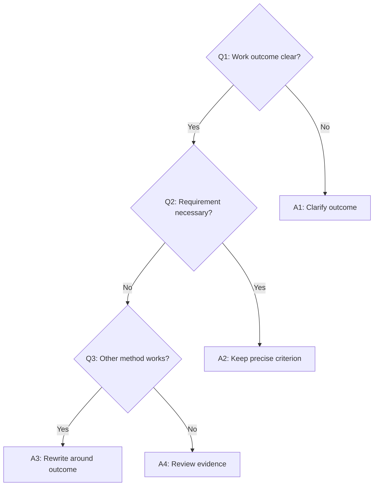

| Node | Question | Yes | No |
| --- | --- | --- | --- |
| Q1 | Is the work outcome behind the requirement clearly defined? | Q2 | A1 |
| Q2 | Is this particular requirement necessary even when different methods and appropriate support are considered? | A2 | Q3 |
| Q3 | Could the outcome be demonstrated or achieved through another method? | A3 | A4 |

| Next-action node | Action and route |
| --- | --- |
| A1 | Define the task, audience, quality and genuine constraints before finalising the criterion; return to Q1. |
| A2 | Retain a precise, evidence-based criterion and explain its relevance; use [DT-06](#dt-06) to choose an assessment. |
| A3 | Rewrite the criterion around the outcome and accept relevant alternative evidence; use [DT-06](#dt-06). |
| A4 | Obtain task evidence and HR review before treating the requirement as essential; do not retain it merely because it is familiar. |

**U — Unknown:** Ask the role owner for examples of actual work and why the requirement exists. Missing justification is not evidence that a candidate lacks ability. Return to the unresolved question after proportionate clarification; retain appropriate interim support.

**P — Preference or declined option:** If a person does not want a suggested method, explore other relevant evidence rather than assuming inability; use [DT-36](#dt-36) where access support is needed.

**Escalation and judgement boundary:** Refer contested requirements, potential exclusion and legal justification questions to HR and the relevant adviser through [DT-33](#dt-33). The tree does not diagnose, determine a legal conclusion or delegate a consequential employment decision to an agent.

**Review and outcome evidence:** Check whether the revised requirement predicts the actual work and whether unnecessary barriers remain. Agree a named owner, next update and how to reopen unresolved work; record only necessary information privately.

**Companion knowledge:** [Recruitment and assessment](#support-recruitment).

[Back to lifecycle index](#lifecycle-index)

<a id="dt-02"></a>

### DT-02 — What flexibility can this role support?

**Stage:** Attraction and role design  
**Trigger:** An advert, working-pattern discussion or review raises a question about hours, location, breaks or job sharing.  
**Intended outcome:** Available flexibility reflects actual tasks, safe coverage and sustainable work.  
**Responsible roles:** Hiring or line manager, supported by operational owners and HR.

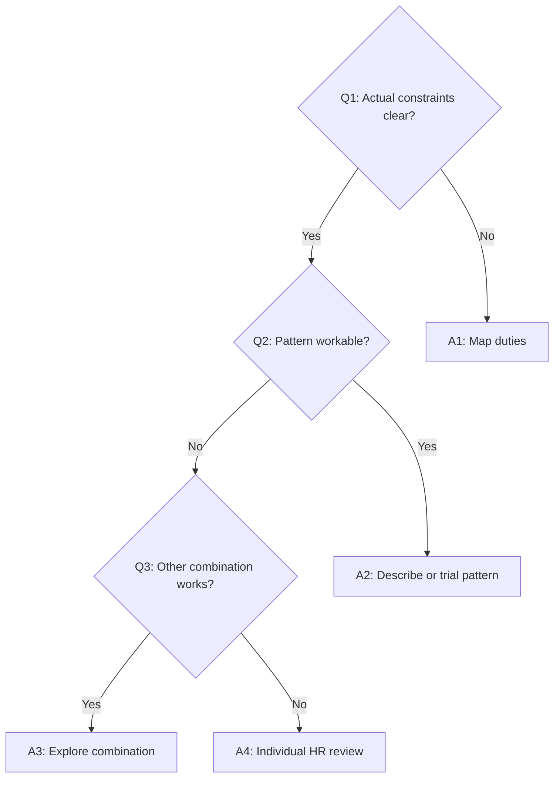

| Node | Question | Yes | No |
| --- | --- | --- | --- |
| Q1 | Are the duties requiring presence, timing or cover actually identified? | Q2 | A1 |
| Q2 | Can the requested or proposed pattern meet those duties with appropriate arrangements? | A2 | Q3 |
| Q3 | Could another combination of shifts, breaks, task sequencing, location or job sharing meet the goal? | A3 | A4 |

| Next-action node | Action and route |
| --- | --- |
| A1 | Map the work and constraints with the operational owner; avoid occupation-wide exclusions and return to Q1. |
| A2 | Describe the genuine available pattern or agree a bounded trial with the person; review its practical operation. |
| A3 | Discuss the alternative combination without presenting it as the only possible answer; route any adjustment need to [DT-36](#dt-36). |
| A4 | Seek an individual HR assessment of the remaining constraints and relevant legal route; explain options without promising or automatically denying flexibility. |

**U — Unknown:** Clarify the task, coverage and desired benefit rather than asking for a diagnostic label. [DT-33](#dt-33) identifies the applicable advice route. Return to the unresolved question after proportionate clarification; retain appropriate interim support.

**P — Preference or declined option:** Ask whether another pattern is acceptable. Declining one proposal does not mean the person has withdrawn their original need.

**Escalation and judgement boundary:** Use [DT-40](#dt-40) for a disputed decision and [DT-34](#dt-34) for urgent safety or essential-access issues. The tree does not diagnose, determine a legal conclusion or delegate a consequential employment decision to an agent.

**Review and outcome evidence:** Review coverage, quality, workload, access effort and the person’s experience rather than presence alone. Agree a named owner, next update and how to reopen unresolved work; record only necessary information privately.

**Companion knowledge:** [Work design and environments](#support-work-design).

[Back to lifecycle index](#lifecycle-index)

<a id="dt-03"></a>

### DT-03 — Can someone understand and pursue this opportunity?

**Stage:** Attraction and role design  
**Trigger:** An opportunity is about to be advertised, or an applicant reports unclear or unusable information.  
**Intended outcome:** People can understand the role, assess the opportunity and reach a usable application route.  
**Responsible roles:** Recruiter and hiring manager, with content and recruitment-system owners.

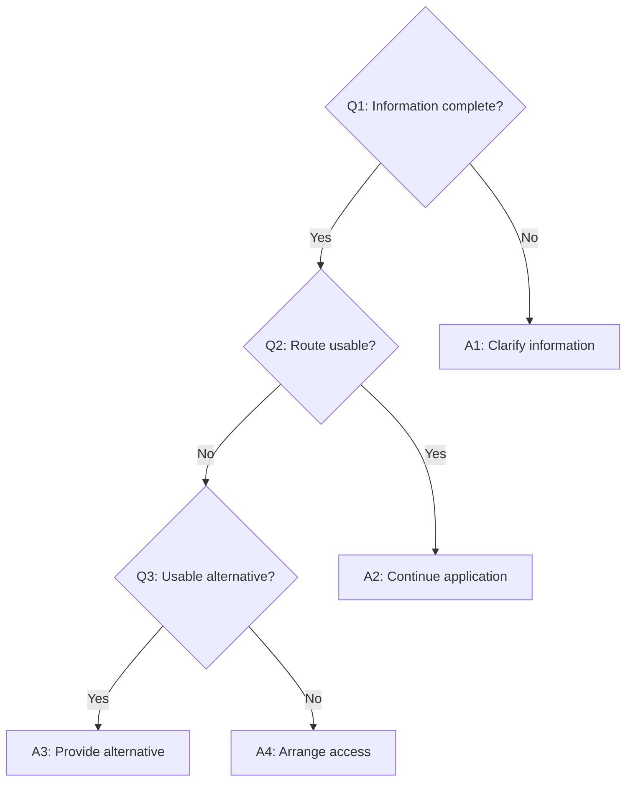

| Node | Question | Yes | No |
| --- | --- | --- | --- |
| Q1 | Does the information clearly describe tasks, pay, format, available working patterns and an access contact? | Q2 | A1 |
| Q2 | Can intended applicants use the information and application route? | A2 | Q3 |
| Q3 | Is an equivalent usable route available while the defect is repaired? | A3 | A4 |

| Next-action node | Action and route |
| --- | --- |
| A1 | Complete or clarify the information before relying on it for selection; provide usable formats and return to Q1. |
| A2 | Proceed to application support under [DT-04](#dt-04), keeping the access contact available. |
| A3 | Offer the alternative without disadvantage, keep information equivalent and assign the original defect to its owner. |
| A4 | Arrange an accessible route with the recruitment owner; review timing and avoid excluding someone because the system failed. |

**U — Unknown:** Check real documents and workflows rather than assuming that a platform or PDF is accessible. Seek relevant testing without requiring unnecessary candidate data. Return to the unresolved question after proportionate clarification; retain appropriate interim support.

**P — Preference or declined option:** Offer another usable format or contact method. Do not treat refusal to use an inaccessible channel as lack of interest.

**Escalation and judgement boundary:** Escalate unresolved application exclusion to the recruitment service owner and HR; use [DT-34](#dt-34) if timing makes access urgent. The tree does not diagnose, determine a legal conclusion or delegate a consequential employment decision to an agent.

**Review and outcome evidence:** Verify that people can understand the opportunity, obtain answers and begin an application. Agree a named owner, next update and how to reopen unresolved work; record only necessary information privately.

**Companion knowledge:** [Recruitment and assessment](#support-recruitment).

[Back to lifecycle index](#lifecycle-index)

<a id="dt-04"></a>

### DT-04 — Is the application process usable?

**Stage:** Application and assessment  
**Trigger:** A person cannot register, authenticate, submit information or complete an application step.  
**Intended outcome:** The person can apply without unnecessary disclosure, dependence or disadvantage.  
**Responsible roles:** Recruitment service owner, with IT/product or procurement as appropriate.


| Node | Question | Yes | No |
| --- | --- | --- | --- |
| Q1 | Is any step blocking the person from completing the application goal? | Q2 | A1 |
| Q2 | Does an available alternative preserve information, privacy and a fair opportunity? | A2 | Q3 |
| Q3 | Can the service owner provide or commission a usable alternative promptly? | A3 | A4 |

| Next-action node | Action and route |
| --- | --- |
| A1 | Continue through the usable application route, keep the access contact available and revisit if circumstances change. |
| A2 | Provide the alternative, explain how evidence will be handled and continue repair through [DT-15](#dt-15). |
| A3 | Agree a named implementation owner, realistic next update and appropriate timing arrangements; verify the full application goal. |
| A4 | Escalate to recruitment leadership and HR for a workable route; do not mark system failure as candidate failure. |

**U — Unknown:** Walk through the goal, device, interaction method and failed step with permission. Do not demand a diagnosis or ask the person to repeatedly prove the same defect. Return to the unresolved question after proportionate clarification; retain appropriate interim support.

**P — Preference or declined option:** Explore another route. Assistance from a colleague or recruiter must not be imposed where it removes privacy or control.

**Escalation and judgement boundary:** Use [DT-40](#dt-40) for unresolved exclusion or a disputed assessment of the application; legal questions go through [DT-33](#dt-33). The tree does not diagnose, determine a legal conclusion or delegate a consequential employment decision to an agent.

**Review and outcome evidence:** Check submission, confirmation, correction and follow-up, not only whether the form opens. Agree a named owner, next update and how to reopen unresolved work; record only necessary information privately.

**Companion knowledge:** [Systems, benefits and procurement](#support-systems).

[Back to lifecycle index](#lifecycle-index)

<a id="dt-05"></a>

### DT-05 — What preparation and assessment adjustments are needed?

**Stage:** Application and assessment  
**Trigger:** An interview, test or work sample is planned, or a candidate requests support.  
**Intended outcome:** The candidate can prepare and demonstrate relevant competence through a usable assessment.  
**Responsible roles:** Hiring manager and recruiter, with HR and relevant access-support providers.

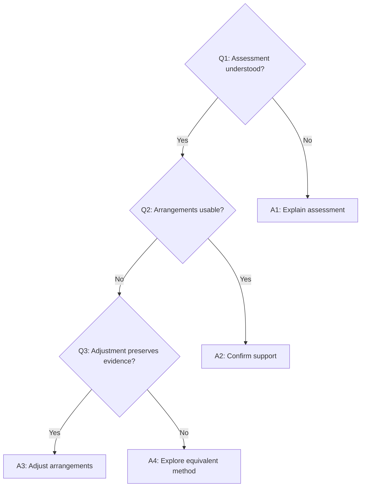

| Node | Question | Yes | No |
| --- | --- | --- | --- |
| Q1 | Are the format, criteria, materials, timing and access arrangements understood? | Q2 | A1 |
| Q2 | Are the proposed arrangements usable and acceptable to the candidate? | A2 | Q3 |
| Q3 | Can the assessment be adjusted without losing the relevant evidence standard? | A3 | A4 |

| Next-action node | Action and route |
| --- | --- |
| A1 | Explain the assessment accessibly, invite practical needs and allow appropriate preparation; return to Q1. |
| A2 | Confirm delivery responsibilities and test relevant arrangements before the assessment; use [DT-06](#dt-06) for method selection. |
| A3 | Agree changes to communication, processing time, materials, breaks, environment or tools; use [DT-36](#dt-36) to coordinate delivery. |
| A4 | Ask HR and the assessment owner to explore an equivalent method and relevant legal questions; do not assume that the original format is essential. |

**U — Unknown:** Ask about practical preparation and participation, not a general medical history. Check any unrehearsed element against the competence actually assessed. Return to the unresolved question after proportionate clarification; retain appropriate interim support.

**P — Preference or declined option:** Offer another way to demonstrate the competence and explain what is genuinely necessary. Keep the original support request open unless the person withdraws it.

**Escalation and judgement boundary:** Use [DT-33](#dt-33) for health-question and assessment-duty advice; use [DT-40](#dt-40) for a disputed refusal or penalty. The tree does not diagnose, determine a legal conclusion or delegate a consequential employment decision to an agent.

**Review and outcome evidence:** Verify preparation, communication support and the opportunity to respond; a proposed five-working-day default is practice guidance, not an invented legal deadline. Agree a named owner, next update and how to reopen unresolved work; record only necessary information privately.

**Companion knowledge:** [Recruitment and assessment](#support-recruitment).

[Back to lifecycle index](#lifecycle-index)

<a id="dt-06"></a>

### DT-06 — Which assessment method provides relevant evidence?

**Stage:** Application and assessment  
**Trigger:** A selection team is choosing or reconsidering an interview, task, sample, instrument or trial.  
**Intended outcome:** The method tests relevant work competence rather than access to a preferred social style.  
**Responsible roles:** Hiring manager and HR, with a competent assessment specialist where needed.

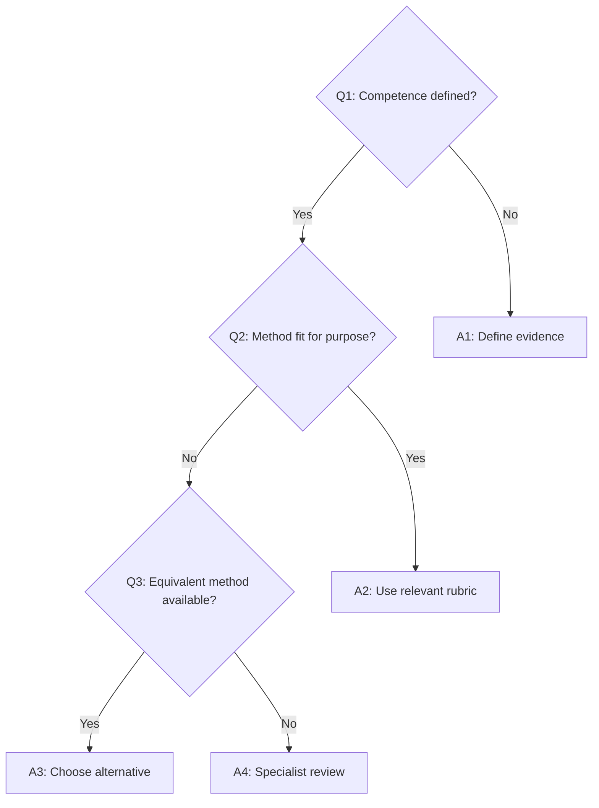

| Node | Question | Yes | No |
| --- | --- | --- | --- |
| Q1 | Is the competence to be assessed defined in observable work terms? | Q2 | A1 |
| Q2 | Does the proposed method measure that competence accessibly and proportionately? | A2 | Q3 |
| Q3 | Could a structured interview, existing sample, adjusted task or appropriate paid trial provide equivalent evidence? | A3 | A4 |

| Next-action node | Action and route |
| --- | --- |
| A1 | Define the outcome and evidence anchors using [DT-01](#dt-01) before choosing a test. |
| A2 | Use a documented rubric, agreed access arrangements and a feedback route; assess the evidence under [DT-07](#dt-07). |
| A3 | Choose and explain the alternative, keep comparable evidence standards and confirm arrangements under [DT-05](#dt-05). |
| A4 | Seek specialist review of necessity, validity and access; do not use personality fit or an unexamined instrument as a shortcut. |

**U — Unknown:** Ask what the method actually adds and how its results should be interpreted. Supplier claims alone do not resolve instrument quality or accessibility. Return to the unresolved question after proportionate clarification; retain appropriate interim support.

**P — Preference or declined option:** Discuss another relevant method. Where a proposed trial or task is declined, clarify the reason and options without inferring inability or a diagnosis.

**Escalation and judgement boundary:** HR should review payment/status questions for trials and any role-specific testing proposal; use [DT-33](#dt-33) for legal starting questions. The tree does not diagnose, determine a legal conclusion or delegate a consequential employment decision to an agent.

**Review and outcome evidence:** Review whether the resulting evidence supports the criterion and whether access or irrelevant demands distorted it. Agree a named owner, next update and how to reopen unresolved work; record only necessary information privately.

**Companion knowledge:** [Recruitment and assessment](#support-recruitment).

[Back to lifecycle index](#lifecycle-index)

<a id="dt-07"></a>

### DT-07 — Is the selection decision based on fair evidence?

**Stage:** Application and assessment  
**Trigger:** A panel is scoring, shortlisting or considering a selection outcome.  
**Intended outcome:** An authorised human decision uses relevant evidence with access failures and uncertainty addressed.  
**Responsible roles:** Authorised hiring panel and HR; the tree does not select or reject a person.

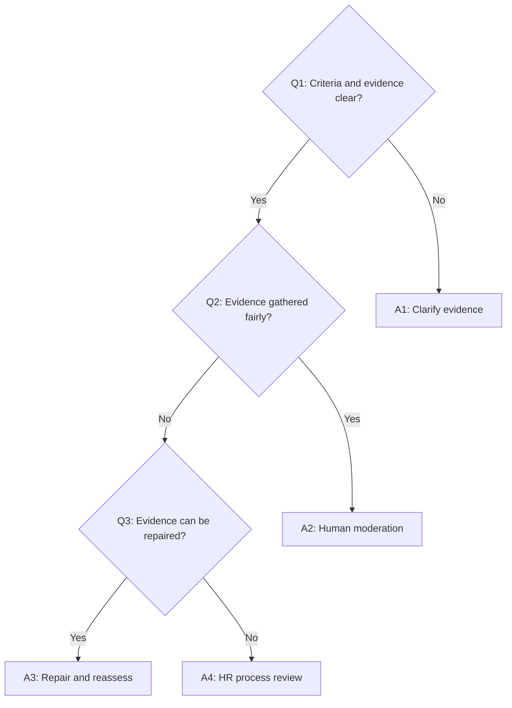

| Node | Question | Yes | No |
| --- | --- | --- | --- |
| Q1 | Are the published role criteria and observable evidence available? | Q2 | A1 |
| Q2 | Was the evidence gathered through a usable process without irrelevant personality or social-conformity proxies? | A2 | Q3 |
| Q3 | Can the affected evidence be fairly reassessed or obtained through an equivalent accessible route? | A3 | A4 |

| Next-action node | Action and route |
| --- | --- |
| A1 | Clarify criteria and missing evidence; do not fill gaps with assumptions about health, personality or motivation. |
| A2 | Ask the panel to moderate the evidence, explain its reasoning and provide accessible feedback and review arrangements. |
| A3 | Repair the process and reassess the affected evidence without penalising the access need; coordinate through [DT-05](#dt-05) and [DT-06](#dt-06). |
| A4 | Pause reliance on the compromised evidence and seek HR review of a fair way forward; do not let an agent determine the outcome. |

**U — Unknown:** Distinguish missing evidence, disputed evidence and demonstrated performance. Uncertainty should trigger clarification, not a confident automated ranking. Return to the unresolved question after proportionate clarification; retain appropriate interim support.

**P — Preference or declined option:** Offer a usable feedback or challenge route. Do not require extra disclosure or turn refusal of a personality exercise into adverse evidence.

**Escalation and judgement boundary:** Use [DT-40](#dt-40) where the panel, criteria or decision are disputed, and [DT-33](#dt-33) for applicable recruitment-law questions. The tree does not diagnose, determine a legal conclusion or delegate a consequential employment decision to an agent.

**Review and outcome evidence:** Check that reasons relate to genuine work criteria and that process repair was completed before final judgement. Agree a named owner, next update and how to reopen unresolved work; record only necessary information privately.

**Companion knowledge:** [Recruitment and assessment](#support-recruitment).

[Back to lifecycle index](#lifecycle-index)

<a id="dt-08"></a>

### DT-08 — What needs to be ready before the start date?

**Stage:** Offer and pre-start  
**Trigger:** An offer is accepted or starting arrangements are being discussed.  
**Intended outcome:** The person can begin with usable access, tools, information and practical support.  
**Responsible roles:** Line manager and onboarding coordinator, with HR, IT and facilities owners.

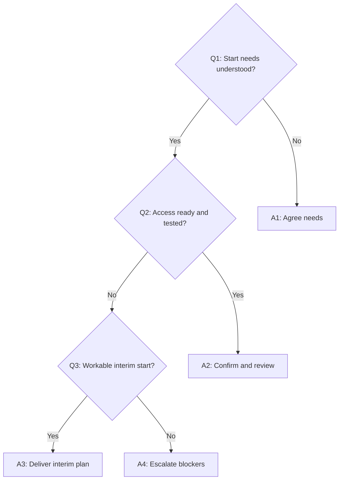

| Node | Question | Yes | No |
| --- | --- | --- | --- |
| Q1 | Are the first-day goals and practical access arrangements understood? | Q2 | A1 |
| Q2 | Are the required systems, equipment, premises and communication arrangements ready and verified? | A2 | Q3 |
| Q3 | Can interim arrangements provide a workable start while outstanding items are delivered? | A3 | A4 |

| Next-action node | Action and route |
| --- | --- |
| A1 | Agree the work setting, induction, communication and essential tasks privately with the person; return to Q1. |
| A2 | Confirm instructions, named contacts and an early review; continue under [DT-10](#dt-10). |
| A3 | Agree the interim plan, delivery owners and next updates; avoid exposing private information or transferring the burden to the starter. |
| A4 | Escalate essential blockers to the relevant service owner and HR; review practical start arrangements with the person rather than blaming them for missing access. |

**U — Unknown:** Ask only what is needed to make the start workable. Check actual task access rather than assuming an order or licence means readiness. Return to the unresolved question after proportionate clarification; retain appropriate interim support.

**P — Preference or declined option:** Explore an acceptable alternative and its effect on the start. A passport, diagnosis or optional technology must not become a prerequisite for ordinary support.

**Escalation and judgement boundary:** Use [DT-34](#dt-34) for urgent essential access, [DT-38](#dt-38) for ownership/funding and [DT-40](#dt-40) for unresolved or disputed decisions. The tree does not diagnose, determine a legal conclusion or delegate a consequential employment decision to an agent.

**Review and outcome evidence:** Verify that the person can arrive or connect, authenticate, obtain information and undertake useful induction work. Agree a named owner, next update and how to reopen unresolved work; record only necessary information privately.

**Companion knowledge:** [Onboarding and continuity](#support-onboarding).

[Back to lifecycle index](#lifecycle-index)

<a id="dt-09"></a>

### DT-09 — How should support information be recorded and shared?

**Stage:** Offer and pre-start  
**Trigger:** A passport, support record or pre-start handover is proposed.  
**Intended outcome:** Necessary functional support is recorded accurately with restricted, understood sharing.  
**Responsible roles:** HR and the coordinating manager, involving the person and privacy expertise where needed.

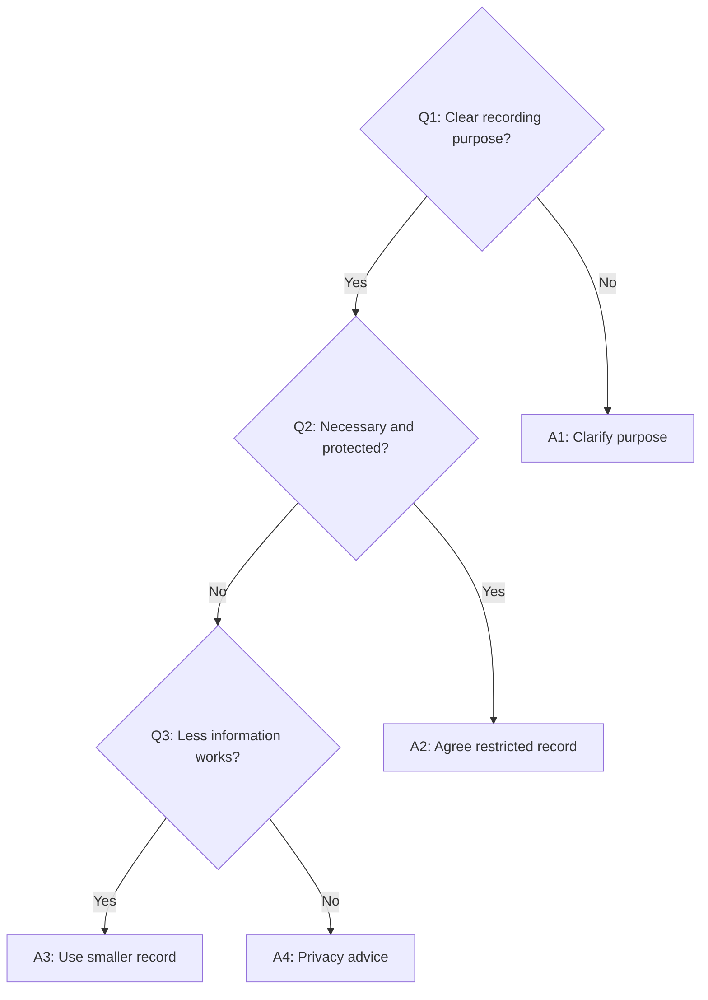

| Node | Question | Yes | No |
| --- | --- | --- | --- |
| Q1 | Does the proposed record have a clear support or continuity purpose? | Q2 | A1 |
| Q2 | Is its content limited to necessary functional arrangements with appropriate access and correction? | A2 | Q3 |
| Q3 | Can a smaller record or different handover meet the purpose? | A3 | A4 |

| Next-action node | Action and route |
| --- | --- |
| A1 | Do not collect a record merely because a template exists; clarify the purpose through [DT-35](#dt-35). |
| A2 | Agree the record, recipients, delivery owners and review triggers; keep it in the approved confidential system. |
| A3 | Use the less intrusive arrangement, confirm what may be shared and provide a correction route. |
| A4 | Seek privacy/HR advice before expanding collection or sharing; maintain practical support without using paperwork as a barrier. |

**U — Unknown:** Clarify purpose, recipients and storage before collecting details. Agreement about preferences does not settle every data-protection question. Return to the unresolved question after proportionate clarification; retain appropriate interim support.

**P — Preference or declined option:** Respect a decision not to use an optional passport. Offer another confidential way to coordinate support; explain any separate necessary record and seek advice if disputed.

**Escalation and judgement boundary:** Use [DT-35](#dt-35) for information questions and [DT-40](#dt-40) where sharing, correction or a record requirement is disputed. The tree does not diagnose, determine a legal conclusion or delegate a consequential employment decision to an agent.

**Review and outcome evidence:** Check that the record is accurate, used only as intended and helpful at the next handover. Agree a named owner, next update and how to reopen unresolved work; record only necessary information privately.

**Companion knowledge:** [Privacy, support records and data](#support-privacy).

[Back to lifecycle index](#lifecycle-index)

<a id="dt-10"></a>

### DT-10 — Can the person access and understand induction?

**Stage:** Induction and probation  
**Trigger:** Induction, mandatory learning or an initial explanation of work is being delivered.  
**Intended outcome:** The person can learn, ask questions and find relevant information again.  
**Responsible roles:** Line manager and learning/onboarding owner.

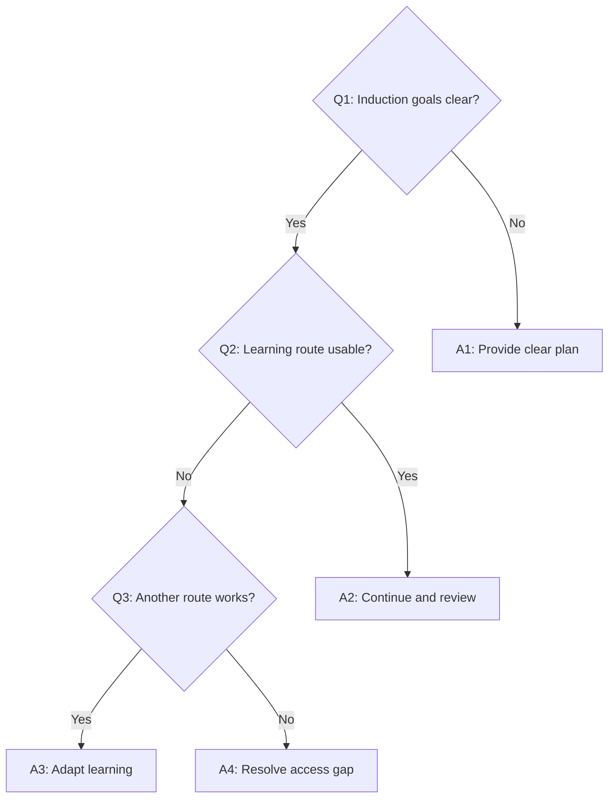

| Node | Question | Yes | No |
| --- | --- | --- | --- |
| Q1 | Are goals, priorities, timetable and support contacts clear? | Q2 | A1 |
| Q2 | Are the formats, pace, tools and practice opportunities usable? | A2 | Q3 |
| Q3 | Would a different format, demonstration, practice environment or sequence address the difficulty? | A3 | A4 |

| Next-action node | Action and route |
| --- | --- |
| A1 | Provide a concise accessible plan with priorities and contacts; check understanding without testing memory as a proxy for engagement. |
| A2 | Continue induction and agree an early experience review under [DT-12](#dt-12). |
| A3 | Adapt delivery with the person, assign an owner and allow meaningful practice before assessing outcomes. |
| A4 | Involve the learning/service owner and relevant expertise; provide interim information and avoid treating inaccessible induction as failed engagement. |

**U — Unknown:** Ask which part is difficult to find, interpret or operate. Distinguish unfamiliar work from a tool, language, format or environmental barrier. Return to the unresolved question after proportionate clarification; retain appropriate interim support.

**P — Preference or declined option:** Offer another learning route. Declining a recording, group session or long manual does not imply refusal to learn.

**Escalation and judgement boundary:** Use [DT-15](#dt-15) for system failures, [DT-36](#dt-36) for support coordination and [DT-40](#dt-40) for a disputed consequence. The tree does not diagnose, determine a legal conclusion or delegate a consequential employment decision to an agent.

**Review and outcome evidence:** Check practical application, confidence and access to help rather than attendance or module completion alone. Agree a named owner, next update and how to reopen unresolved work; record only necessary information privately.

**Companion knowledge:** [Onboarding and continuity](#support-onboarding).

[Back to lifecycle index](#lifecycle-index)

<a id="dt-11"></a>

### DT-11 — Is an early difficulty about learning, access or expectations?

**Stage:** Induction and probation  
**Trigger:** A new starter appears to struggle, misses an induction task or receives an early performance concern.  
**Intended outcome:** The cause is explored fairly and useful support precedes unsupported capability conclusions.  
**Responsible roles:** Line manager with HR and relevant training/service owners.

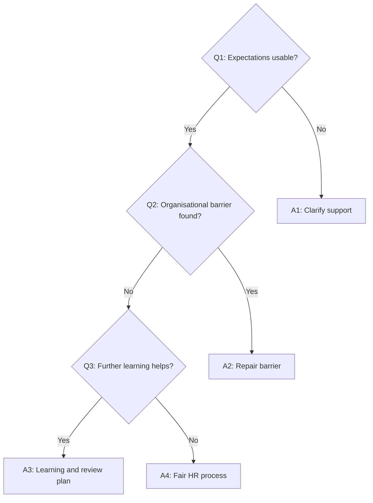

| Node | Question | Yes | No |
| --- | --- | --- | --- |
| Q1 | Are the expected result, training and available support clear and usable? | Q2 | A1 |
| Q2 | Does the discussion or task evidence identify an organisational access or work-design barrier? | A2 | Q3 |
| Q3 | Would further practice, clearer feedback or proportionate investigation clarify the concern? | A3 | A4 |

| Next-action node | Action and route |
| --- | --- |
| A1 | Clarify the task, priorities and support; use [DT-10](#dt-10) and avoid judging a person against unclear expectations. |
| A2 | Assign and repair the barrier through [DT-15](#dt-15) or [DT-36](#dt-36); agree fair review of the affected work. |
| A3 | Agree a focused learning/review plan and gather relevant evidence with the person, not diagnostic speculation. |
| A4 | Use [DT-17](#dt-17) with HR to examine the remaining concern through an accessible fair process; the tree does not decide probation. |

**U — Unknown:** Separate observed actions from assumptions about motivation, disability or competence. Ask what information would resolve the uncertainty. Return to the unresolved question after proportionate clarification; retain appropriate interim support.

**P — Preference or declined option:** Discuss another support or feedback route. A declined option should not automatically become a negative probation judgement.

**Escalation and judgement boundary:** Use [DT-40](#dt-40) for disputed probation decisions or a concern about the manager; use [DT-34](#dt-34) for urgent safety matters. The tree does not diagnose, determine a legal conclusion or delegate a consequential employment decision to an agent.

**Review and outcome evidence:** Review actual work after usable instruction and delivered support, recording what remains uncertain. Agree a named owner, next update and how to reopen unresolved work; record only necessary information privately.

**Companion knowledge:** [Performance, absence and formal procedures](#support-performance).

[Back to lifecycle index](#lifecycle-index)

<a id="dt-12"></a>

### DT-12 — Are the initial working arrangements effective?

**Stage:** Induction and probation  
**Trigger:** The person has begun real work and an initial support or work-pattern review is due.  
**Intended outcome:** Initial arrangements become practical, effective and sustainable in the real setting.  
**Responsible roles:** Line manager with the person and owners implementing the arrangements.

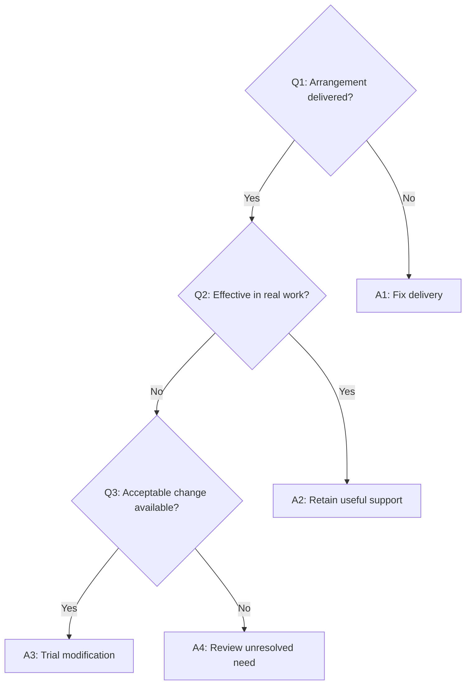

| Node | Question | Yes | No |
| --- | --- | --- | --- |
| Q1 | Have the agreed arrangements actually been delivered? | Q2 | A1 |
| Q2 | Can the person achieve the relevant goals with acceptable effort, privacy and independence? | A2 | Q3 |
| Q3 | Does the person want to try a feasible modification or alternative? | A3 | A4 |

| Next-action node | Action and route |
| --- | --- |
| A1 | Resolve missing delivery and ownership under [DT-38](#dt-38); keep interim support and do not label a non-delivered arrangement ineffective. |
| A2 | Retain the useful arrangements, agree ongoing review and check forthcoming transitions. |
| A3 | Agree a bounded change, success questions and review date through [DT-36](#dt-36) and [DT-37](#dt-37). |
| A4 | Continue a private discussion and use [DT-37](#dt-37)/[DT-40](#dt-40) where unresolved; do not force a failed option or close the need because one response was declined. |

**U — Unknown:** Ask about actual tasks and experience, including workload and recovery. Do not infer success from silence or an apparently comfortable presentation. Return to the unresolved question after proportionate clarification; retain appropriate interim support.

**P — Preference or declined option:** Respect a decision to stop an optional trial or use a different method; maintain support and clarify the remaining barrier.

**Escalation and judgement boundary:** Use [DT-34](#dt-34) if the initial arrangement leaves essential access or safety unresolved, and [DT-40](#dt-40) for disagreement. The tree does not diagnose, determine a legal conclusion or delegate a consequential employment decision to an agent.

**Review and outcome evidence:** Check the person’s view alongside observed task outcomes; review after changes rather than repeatedly requesting proof of diagnosis. Agree a named owner, next update and how to reopen unresolved work; record only necessary information privately.

**Companion knowledge:** [Barrier conversations, adjustment delivery and review](#support-adjustments).

[Back to lifecycle index](#lifecycle-index)

<a id="dt-13"></a>

### DT-13 — Can everyone participate in this communication or meeting?

**Stage:** Daily work and benefits  
**Trigger:** A meeting, conversation, collaboration session or decision channel is being planned or is excluding someone.  
**Intended outcome:** People can understand, contribute and influence the decision through usable methods.  
**Responsible roles:** Meeting organiser or line manager, with participants and relevant support providers.

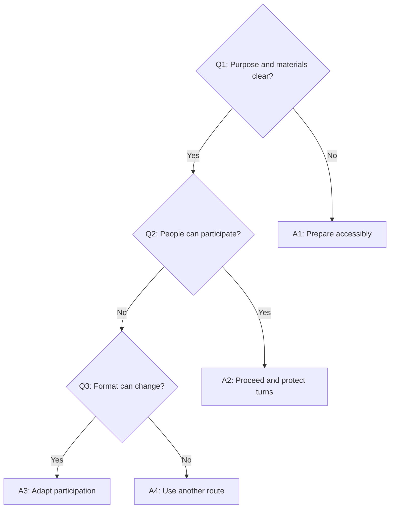

| Node | Question | Yes | No |
| --- | --- | --- | --- |
| Q1 | Are the purpose, materials and ways to contribute clear and available in time? | Q2 | A1 |
| Q2 | Can participants follow and contribute using their chosen effective communication arrangements? | A2 | Q3 |
| Q3 | Can the format, turn-taking, timing or support be changed to restore participation? | A3 | A4 |

| Next-action node | Action and route |
| --- | --- |
| A1 | Provide an accessible agenda/materials and explain decisions needed; allow appropriate preparation and return to Q1. |
| A2 | Proceed with protected contribution time, usable action summaries and a realistic response window. |
| A3 | Agree changes such as AAC time, signed/captioned support, quiet acoustics or text input; test them and preserve the opportunity to influence. |
| A4 | Use another accessible decision route or pause the affected decision where appropriate; involve the relevant owner rather than treating presence as participation. |

**U — Unknown:** Ask privately about language and access preferences. Do not assume signing, lipreading or rapid chat from an identity or diagnosis. Return to the unresolved question after proportionate clarification; retain appropriate interim support.

**P — Preference or declined option:** Offer another usable contribution method; do not impose public speaking, recording, sign-language teaching or unnecessary disclosure.

**Escalation and judgement boundary:** Use [DT-36](#dt-36) for support arrangements and [DT-40](#dt-40) if a consequential decision excluded someone or is disputed. The tree does not diagnose, determine a legal conclusion or delegate a consequential employment decision to an agent.

**Review and outcome evidence:** Check understanding and influence, not merely attendance, transcript availability or a contribution submitted after an irreversible decision. Agree a named owner, next update and how to reopen unresolved work; record only necessary information privately.

**Companion knowledge:** [Communication and participation](#support-communication).

[Back to lifecycle index](#lifecycle-index)

<a id="dt-14"></a>

### DT-14 — Does the work design or environment create a barrier?

**Stage:** Daily work and benefits  
**Trigger:** The person reports difficulty with tasks, workload, sensory conditions, physical access or working patterns.  
**Intended outcome:** Work is usable, sustainable and appropriately safe without unnecessary conformity.  
**Responsible roles:** Line manager with facilities, safety and process owners as relevant.

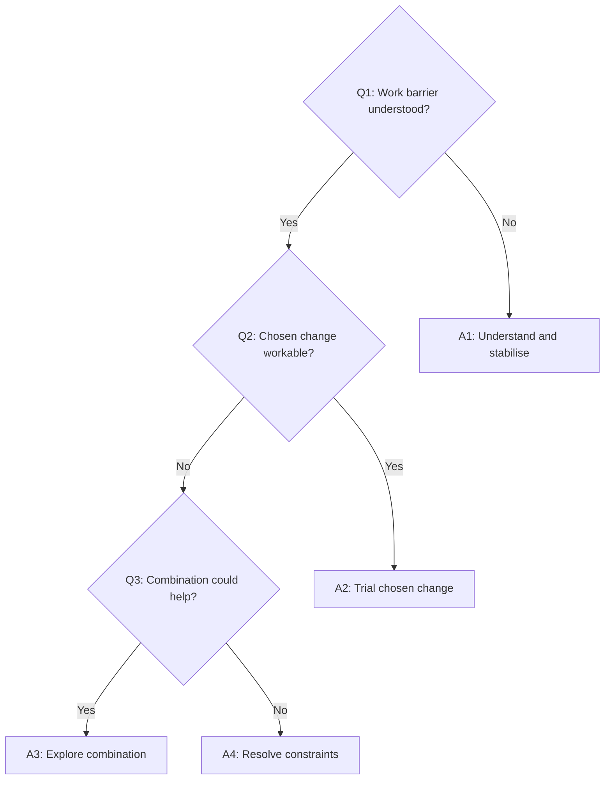

| Node | Question | Yes | No |
| --- | --- | --- | --- |
| Q1 | Are the goal, context and reported barrier understood? | Q2 | A1 |
| Q2 | Is there a practical change the person wants to try that avoids unacceptable effects on others or safety? | A2 | Q3 |
| Q3 | Could a combination of space, equipment, timing, task design or specialist advice resolve the remaining constraints? | A3 | A4 |

| Next-action node | Action and route |
| --- | --- |
| A1 | Use [DT-36](#dt-36) to understand the task and arrange interim support; do not choose equipment from a diagnostic label. |
| A2 | Agree a bounded trial with ownership, safe cover where needed and meaningful review. |
| A3 | Explore the combination with affected people and relevant owners, including competing needs such as quiet and voice input. |
| A4 | Escalate the specific unresolved constraint through [DT-38](#dt-38)/[DT-40](#dt-40); retain appropriate interim access rather than insisting the person adapt to a fixed habit. |

**U — Unknown:** Clarify physical, cognitive, sensory, social and workload factors without assuming one medical cause. Use [DT-34](#dt-34) if risk may be urgent. Return to the unresolved question after proportionate clarification; retain appropriate interim support.

**P — Preference or declined option:** Ask about other options. Declining headphones, hot-desking, buddying or a proposed schedule does not settle the original barrier.

**Escalation and judgement boundary:** Involve qualified safety or other expertise for specialist questions; HR/legal review rights-sensitive constraints through [DT-33](#dt-33). The tree does not diagnose, determine a legal conclusion or delegate a consequential employment decision to an agent.

**Review and outcome evidence:** Review quality, access effort, recovery, privacy, autonomy and effects on the whole work arrangement. Agree a named owner, next update and how to reopen unresolved work; record only necessary information privately.

**Companion knowledge:** [Work design and environments](#support-work-design).

[Back to lifecycle index](#lifecycle-index)

<a id="dt-15"></a>

### DT-15 — Can the person use this system or benefit independently and confidentially?

**Stage:** Daily work and benefits  
**Trigger:** A digital tool, document, payroll, learning or wellbeing service cannot be used as intended.  
**Intended outcome:** The full goal is achievable with timely confidential access while the underlying cause is repaired.  
**Responsible roles:** Service owner; internal product/IT, procurement/vendor management or commissioning HR as appropriate.

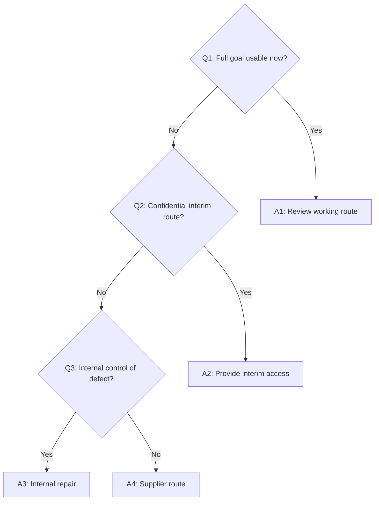

| Node | Question | Yes | No |
| --- | --- | --- | --- |
| Q1 | Can the intended end-to-end goal be completed acceptably through the current route? | A1 | Q2 |
| Q2 | Is there a timely interim route preserving privacy, dignity and control? | A2 | Q3 |
| Q3 | Is the barrier within an internal system or process the organisation controls directly? | A3 | A4 |

| Next-action node | Action and route |
| --- | --- |
| A1 | Record the working context and check that important alternative tasks remain usable; review after changes. |
| A2 | Provide the interim route with the person and assign permanent repair; do not close solely because a workaround exists. |
| A3 | Assign the internal product/process owner; reproduce using minimum or synthetic data and verify repair against the full goal. |
| A4 | Route supplier issues through procurement and the service owner, involving commissioning HR for benefits; seek verified repair while maintaining access. |

**U — Unknown:** Identify the goal, failed step, version and interaction method. Unclear ownership goes to [DT-38](#dt-38); an uncertain cause does not justify denying access. Return to the unresolved question after proportionate clarification; retain appropriate interim support.

**P — Preference or declined option:** Explore another interim route. Do not force someone to expose health or financial information to a colleague to obtain the service.

**Escalation and judgement boundary:** Use [DT-34](#dt-34) for urgent pay, safety or confidentiality concerns and [DT-40](#dt-40) for persistent exclusion. Procurement/legal own contract remedies and payment decisions. The tree does not diagnose, determine a legal conclusion or delegate a consequential employment decision to an agent.

**Review and outcome evidence:** Retest authentication, task steps, recovery, support and outputs. Use voluntary task analysis to assess system burden, not employee capacity. Agree a named owner, next update and how to reopen unresolved work; record only necessary information privately.

**Companion knowledge:** [Systems, benefits and procurement](#support-systems).

[Back to lifecycle index](#lifecycle-index)

<a id="dt-16"></a>

### DT-16 — Is this shared activity or team solution inclusive?

**Stage:** Daily work and benefits  
**Trigger:** An event, team exercise, shared process or proposed workaround creates an access issue.  
**Intended outcome:** The person has meaningful, chosen participation with dignity and appropriately independent access.  
**Responsible roles:** Activity organiser and line manager, with affected people and the process owner.

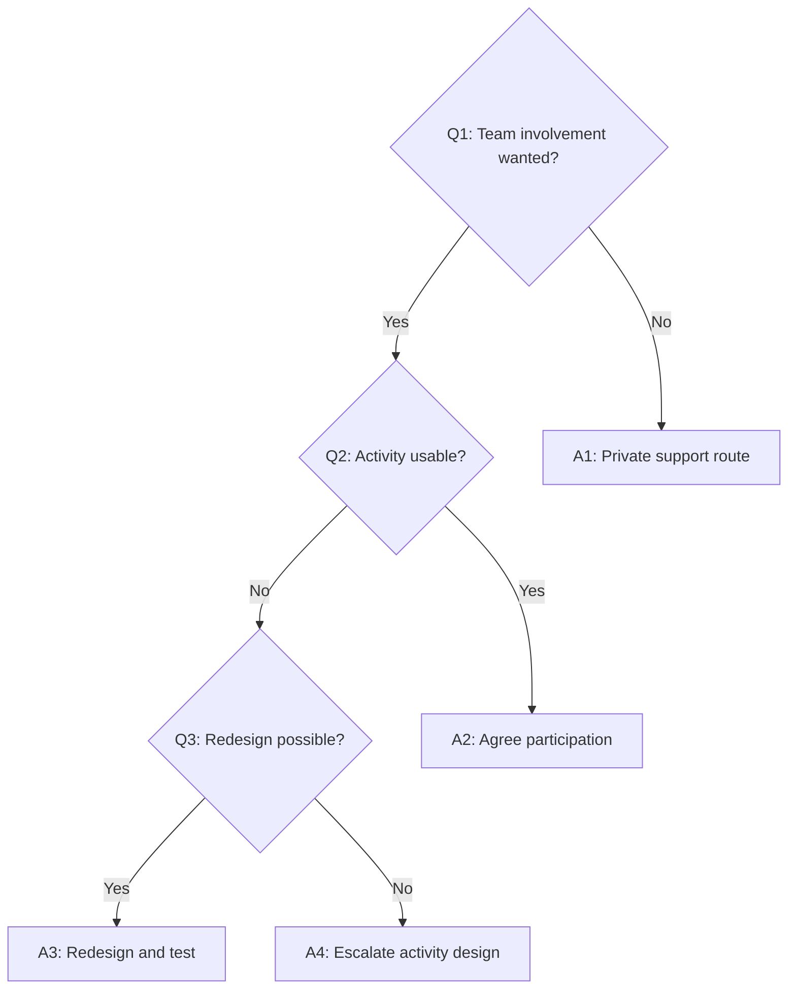

| Node | Question | Yes | No |
| --- | --- | --- | --- |
| Q1 | Does the person want collaborative exploration, and are sharing boundaries understood? | Q2 | A1 |
| Q2 | Is the proposed activity or solution usable without compulsory assistance or unnecessary disclosure? | A2 | Q3 |
| Q3 | Can it be redesigned or replaced with an equally valued usable option? | A3 | A4 |

| Next-action node | Action and route |
| --- | --- |
| A1 | Offer a private individual route through [DT-36](#dt-36); do not expose the person or make their identity a team puzzle. |
| A2 | Agree participation and check practical effects, choice and the ability to pause or decline. |
| A3 | Explore and trial the redesign with affected people; assistance may be offered as a choice rather than the permanent default. |
| A4 | Escalate the activity’s design to its owner and maintain meaningful alternatives; do not make exclusion the employee’s problem to solve. |

**U — Unknown:** Ask about the goal and actual participation barrier. Consider competing access needs and workload rather than assuming a buddy resolves the issue. Return to the unresolved question after proportionate clarification; retain appropriate interim support.

**P — Preference or declined option:** Respect the decision and offer a comparable opportunity where appropriate; do not attach a social, performance or progression penalty to declining an optional activity.

**Escalation and judgement boundary:** Use [DT-40](#dt-40) if refusal, stigma, disclosure or loss of opportunity becomes a concern. The tree does not diagnose, determine a legal conclusion or delegate a consequential employment decision to an agent.

**Review and outcome evidence:** Check influence, access, status, privacy and sustainable assistance. Share process learning only within agreed boundaries. Agree a named owner, next update and how to reopen unresolved work; record only necessary information privately.

**Companion knowledge:** [Culture and team solutions](#support-culture).

[Back to lifecycle index](#lifecycle-index)

<a id="dt-17"></a>

### DT-17 — How should a performance or conduct concern be investigated?

**Stage:** Daily work and benefits  
**Trigger:** A manager raises a concern about output, attendance-related work effects or conduct.  
**Intended outcome:** Relevant evidence is assessed fairly, with barriers and delivered support examined before judgement.  
**Responsible roles:** Line manager and HR; authorised humans retain consequential decisions.

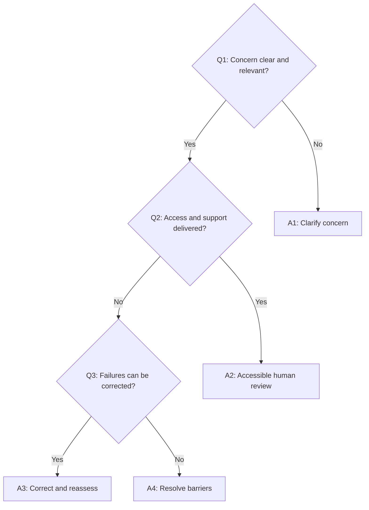

| Node | Question | Yes | No |
| --- | --- | --- | --- |
| Q1 | Are the expectation and observable concern clear and relevant to the actual work? | Q2 | A1 |
| Q2 | Were usable instructions, training, tools, workload and agreed support in place? | A2 | Q3 |
| Q3 | Can identified delivery or access failures be addressed and the affected work fairly reviewed? | A3 | A4 |

| Next-action node | Action and route |
| --- | --- |
| A1 | Clarify the work evidence and expectation; exclude unsupported personality, eye-contact and motivation assumptions. |
| A2 | Discuss the evidence and person’s response through an accessible process; HR advises on appropriate next steps rather than an agent deciding the outcome. |
| A3 | Correct the failures, agree support and a sustainable plan, then review relevant evidence at an appropriate point. |
| A4 | Escalate unresolved barriers or disputed facts to HR and relevant owners; maintain a fair response and challenge route. |

**U — Unknown:** Separate fact, inference and unanswered questions. Do not infer a diagnosis or assume every concern is disability-related. Return to the unresolved question after proportionate clarification; retain appropriate interim support.

**P — Preference or declined option:** Clarify the specific option declined and offer usable alternatives. Do not equate declining one support method with accepting the concern or refusing all support.

**Escalation and judgement boundary:** Use [DT-34](#dt-34) for immediate safety/harassment risk and [DT-40](#dt-40) for independent review, serious disputes or concerns about the manager. The tree does not diagnose, determine a legal conclusion or delegate a consequential employment decision to an agent.

**Review and outcome evidence:** Check both the work outcome and whether promised support was delivered; do not use this tree to determine lawful discipline or dismissal. Agree a named owner, next update and how to reopen unresolved work; record only necessary information privately.

**Companion knowledge:** [Performance, absence and formal procedures](#support-performance).

[Back to lifecycle index](#lifecycle-index)

<a id="dt-18"></a>

### DT-18 — Can the person access this learning opportunity?

**Stage:** Learning and reward  
**Trigger:** Training, a qualification, a development activity or mandatory learning is planned.  
**Intended outcome:** People can obtain the learning and demonstrate what matters through usable methods.  
**Responsible roles:** Learning owner and line manager, with the person and relevant access providers.

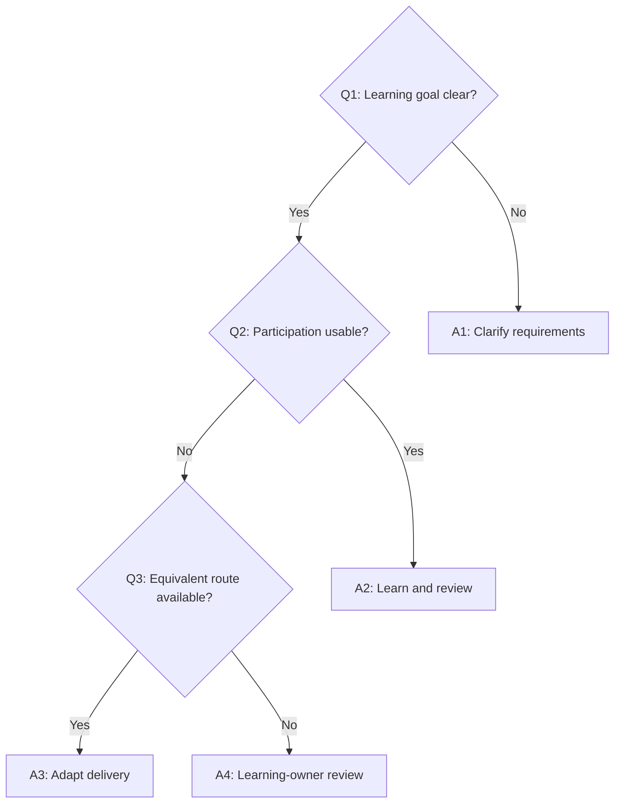

| Node | Question | Yes | No |
| --- | --- | --- | --- |
| Q1 | Are the learning goal, participation requirements and assessment method clear? | Q2 | A1 |
| Q2 | Are timing, format, technology, environment and support usable for the person? | A2 | Q3 |
| Q3 | Can another delivery or evidence route meet the same learning goal? | A3 | A4 |

| Next-action node | Action and route |
| --- | --- |
| A1 | Clarify the purpose and actual requirements; do not confuse attendance style with learning. |
| A2 | Arrange support, practice time and feedback; check practical use of the learning afterwards. |
| A3 | Agree the alternative and maintain equivalent opportunity and evidence standards, using [DT-36](#dt-36) where needed. |
| A4 | Refer the access gap to the learning/service owner and HR; consider another provider or route rather than excluding the learner. |

**U — Unknown:** Ask which part is difficult to obtain, operate or understand and whether working pattern, cost or access effort affects participation. Return to the unresolved question after proportionate clarification; retain appropriate interim support.

**P — Preference or declined option:** Explore another format, pace or opportunity without assuming lack of ambition. Optional development can be declined without compulsory disclosure.

**Escalation and judgement boundary:** Use [DT-15](#dt-15) for technology defects and [DT-40](#dt-40) if access affects progression or mandatory participation is disputed. The tree does not diagnose, determine a legal conclusion or delegate a consequential employment decision to an agent.

**Review and outcome evidence:** Review ability to learn and apply the skill, not only completion records or confidence speaking in a group. Agree a named owner, next update and how to reopen unresolved work; record only necessary information privately.

**Companion knowledge:** [Learning, reward and progression](#support-progression).

[Back to lifecycle index](#lifecycle-index)

<a id="dt-19"></a>

### DT-19 — Are recognition and reward based on relevant contribution?

**Stage:** Learning and reward  
**Trigger:** A reward, recognition, bonus-related contribution review or allocation of development credit is considered.  
**Intended outcome:** Contribution is understood without treating social visibility or access barriers as neutral measures.  
**Responsible roles:** Relevant reward decision-maker and HR, supported by line-management evidence.

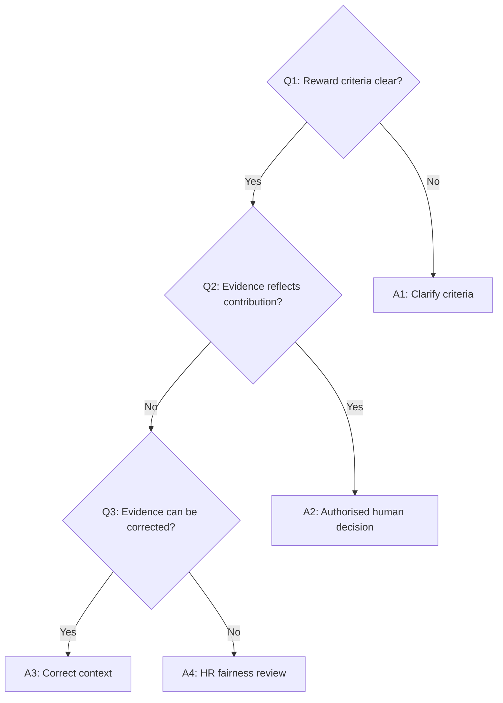

| Node | Question | Yes | No |
| --- | --- | --- | --- |
| Q1 | Are the reward criteria and relevant evidence clear? | Q2 | A1 |
| Q2 | Does the evidence fairly reflect contribution across working patterns and access conditions? | A2 | Q3 |
| Q3 | Can missing context or distorted evidence be corrected before the decision? | A3 | A4 |

| Next-action node | Action and route |
| --- | --- |
| A1 | Clarify the criteria and evidence route before judgement; identify any necessary policy or contractual advice. |
| A2 | Ask the authorised human decision-maker to apply the criteria and provide a usable explanation/review route. |
| A3 | Correct context, consult the person appropriately and reassess the affected evidence rather than rewarding unsupported visibility proxies. |
| A4 | Seek HR review of the unresolved fairness issue; an agent should not award or withhold reward. |

**U — Unknown:** Check eligibility, working pattern, opportunity allocation and barriers that shaped the evidence; do not infer cause from a small group difference alone. Return to the unresolved question after proportionate clarification; retain appropriate interim support.

**P — Preference or declined option:** Offer another way to provide evidence or feedback. Do not condition recognition on a public personal story, optional social activity or medical disclosure.

**Escalation and judgement boundary:** Use [DT-40](#dt-40) for contested criteria, inconsistent treatment or a consequential decision that requires independent review. The tree does not diagnose, determine a legal conclusion or delegate a consequential employment decision to an agent.

**Review and outcome evidence:** Review opportunity and evidence quality alongside the outcome, with appropriate privacy and proportionate data. Agree a named owner, next update and how to reopen unresolved work; record only necessary information privately.

**Companion knowledge:** [Learning, reward and progression](#support-progression).

[Back to lifecycle index](#lifecycle-index)

<a id="dt-20"></a>

### DT-20 — Does the person have fair access to development opportunities?

**Stage:** Promotion and progression  
**Trigger:** Stretch work, mentoring, sponsorship or influential assignments are being offered or reviewed.  
**Intended outcome:** Access reflects relevant aspirations and work needs rather than informal visibility or assumptions.  
**Responsible roles:** Line manager and opportunity owner, with HR.

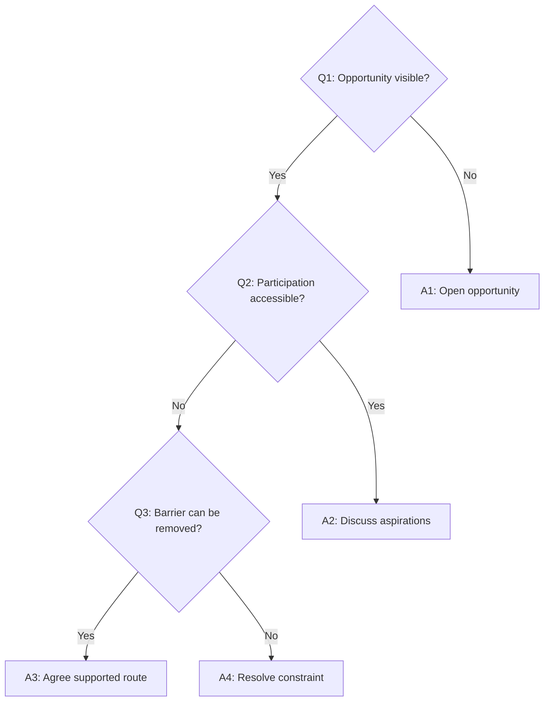

| Node | Question | Yes | No |
| --- | --- | --- | --- |
| Q1 | Are the opportunities, eligibility and allocation process visible and usable? | Q2 | A1 |
| Q2 | Can the person participate through their working pattern and necessary support? | A2 | Q3 |
| Q3 | Can timing, methods, resources or selection arrangements remove the barrier? | A3 | A4 |

| Next-action node | Action and route |
| --- | --- |
| A1 | Make the opportunity and criteria accessible; examine whether informal networks were the only entry route. |
| A2 | Discuss aspirations and make the opportunity available through the relevant fair process; review actual participation. |
| A3 | Agree a supported route with an implementation owner and review; use [DT-36](#dt-36) and [DT-38](#dt-38). |
| A4 | Escalate the specific constraint to the opportunity owner/HR; seek alternatives of comparable value rather than quietly steering the person away. |

**U — Unknown:** Ask about aspiration and practical participation rather than presuming a diagnostic group’s strengths or ambitions. Return to the unresolved question after proportionate clarification; retain appropriate interim support.

**P — Preference or declined option:** Respect the choice and offer future or different development without pressure. Declining an opportunity now does not define long-term potential.

**Escalation and judgement boundary:** Use [DT-40](#dt-40) if recurring allocation, exclusion or a manager’s protective assumptions are challenged. The tree does not diagnose, determine a legal conclusion or delegate a consequential employment decision to an agent.

**Review and outcome evidence:** Check who receives meaningful opportunities and why, avoiding intrusive profiling or unsupported causal claims. Agree a named owner, next update and how to reopen unresolved work; record only necessary information privately.

**Companion knowledge:** [Learning, reward and progression](#support-progression).

[Back to lifecycle index](#lifecycle-index)

<a id="dt-21"></a>

### DT-21 — Is the promotion assessment accessible and relevant?

**Stage:** Promotion and progression  
**Trigger:** A promotion, internal competition or advancement assessment is planned or challenged.  
**Intended outcome:** A person can demonstrate relevant readiness through fair, accessible evidence.  
**Responsible roles:** Authorised promotion panel and HR.

```mermaid
flowchart TD
    Q1{"Q1: Promotion criteria clear?"}
    Q2{"Q2: Assessment accessible?"}
    Q3{"Q3: Equivalent evidence route?"}
    A1["A1: Clarify requirements"]
    A2["A2: Moderate evidence"]
    A3["A3: Adapt assessment"]
    A4["A4: HR review"]
    Q1 -->|Yes| Q2
    Q1 -->|No| A1
    Q2 -->|Yes| A2
    Q2 -->|No| Q3
    Q3 -->|Yes| A3
    Q3 -->|No| A4
```

| Node | Question | Yes | No |
| --- | --- | --- | --- |
| Q1 | Are the role outcomes, criteria and evidence requirements clear? | Q2 | A1 |
| Q2 | Can the person access preparation, assessment and feedback with appropriate support? | A2 | Q3 |
| Q3 | Can the affected process be adjusted or replaced with an equivalent evidence route? | A3 | A4 |

| Next-action node | Action and route |
| --- | --- |
| A1 | Use [DT-01](#dt-01) to clarify genuine requirements before applying criteria. |
| A2 | Use [DT-07](#dt-07) to moderate evidence and support an authorised human decision with accessible reasons and challenge. |
| A3 | Agree and deliver the route under [DT-05](#dt-05) and [DT-06](#dt-06), without treating the access request as adverse evidence. |
| A4 | Seek HR review of the remaining constraint and fair way forward; do not rely on an inaccessible assessment as proof of lack of readiness. |

**U — Unknown:** Clarify the criteria, what evidence exists and any access failure. Do not fill gaps with personality-fit or diagnostic assumptions. Return to the unresolved question after proportionate clarification; retain appropriate interim support.

**P — Preference or declined option:** Explore a usable alternative or feedback route. Declining one assessment format should not automatically become withdrawal from progression.

**Escalation and judgement boundary:** Use [DT-40](#dt-40) for a disputed assessment or panel decision and [DT-33](#dt-33) for relevant legal questions. The tree does not diagnose, determine a legal conclusion or delegate a consequential employment decision to an agent.

**Review and outcome evidence:** Check the fairness of opportunity, evidence and explanation; the tree and an agent do not decide who is promoted. Agree a named owner, next update and how to reopen unresolved work; record only necessary information privately.

**Companion knowledge:** [Learning, reward and progression](#support-progression).

[Back to lifecycle index](#lifecycle-index)

<a id="dt-22"></a>

### DT-22 — Which career route supports the person’s aspirations?

**Stage:** Promotion and progression  
**Trigger:** A career discussion suggests management, specialist work, technical mastery or another direction.  
**Intended outcome:** Development reflects the person’s choices and genuine resourced opportunities.  
**Responsible roles:** Line manager and HR/career-path owner, with the person.

```mermaid
flowchart TD
    Q1{"Q1: Aspirations understood?"}
    Q2{"Q2: Supported route exists?"}
    Q3{"Q3: Other development possible?"}
    A1["A1: Career conversation"]
    A2["A2: Plan opportunity"]
    A3["A3: Explore alternatives"]
    A4["A4: Explain real choices"]
    Q1 -->|Yes| Q2
    Q1 -->|No| A1
    Q2 -->|Yes| A2
    Q2 -->|No| Q3
    Q3 -->|Yes| A3
    Q3 -->|No| A4
```

| Node | Question | Yes | No |
| --- | --- | --- | --- |
| Q1 | Has the person had an accessible opportunity to explain their aspirations? | Q2 | A1 |
| Q2 | Does an existing supported route align with those aspirations? | A2 | Q3 |
| Q3 | Can a different assignment, specialist route or development plan be explored with the relevant owner? | A3 | A4 |

| Next-action node | Action and route |
| --- | --- |
| A1 | Offer a private usable career conversation; avoid assuming ambition or limitations from identity or current presentation. |
| A2 | Explain the real criteria, resources and support; plan relevant opportunities under [DT-20](#dt-20). |
| A3 | Explore feasibility with the person and owner, preserving ambition without promising an unapproved career path. |
| A4 | Explain genuine constraints and available choices, and provide feedback or review without treating one route as the person’s permanent limit. |

**U — Unknown:** Clarify interests, desired outcomes and actual organisational options. A “spiky profile” is not a universal trait or a career prescription. Return to the unresolved question after proportionate clarification; retain appropriate interim support.

**P — Preference or declined option:** Respect a decision not to manage people, mentor, disclose or take a proposed route; explore what the person does want.

**Escalation and judgement boundary:** Use [DT-40](#dt-40) if the person is restricted, discouraged or assessed through unsupported assumptions. The tree does not diagnose, determine a legal conclusion or delegate a consequential employment decision to an agent.

**Review and outcome evidence:** Review aspiration, opportunity, progress and support; do not measure ambition through social conformity. Agree a named owner, next update and how to reopen unresolved work; record only necessary information privately.

**Companion knowledge:** [Learning, reward and progression](#support-progression).

[Back to lifecycle index](#lifecycle-index)

<a id="dt-23"></a>

### DT-23 — How should an absence-related concern be considered?

**Stage:** Absence and return  
**Trigger:** Absence, medical appointments, a trigger point or attendance-related decision needs discussion.  
**Intended outcome:** Individual circumstances and relevant arrangements are considered through a fair confidential process.  
**Responsible roles:** HR and line manager, with appropriate advice and the person’s response.

```mermaid
flowchart TD
    Q1{"Q1: Absence context clear?"}
    Q2{"Q2: Individual arrangements applied?"}
    Q3{"Q3: Change merits consideration?"}
    A1["A1: Clarify privately"]
    A2["A2: Fair HR review"]
    A3["A3: Explore arrangements"]
    A4["A4: Seek appropriate advice"]
    Q1 -->|Yes| Q2
    Q1 -->|No| A1
    Q2 -->|Yes| A2
    Q2 -->|No| Q3
    Q3 -->|Yes| A3
    Q3 -->|No| A4
```

| Node | Question | Yes | No |
| --- | --- | --- | --- |
| Q1 | Are the relevant facts, policy context and reason for the review understood? | Q2 | A1 |
| Q2 | Have applicable individual support and recording/trigger arrangements been considered and delivered? | A2 | Q3 |
| Q3 | Would a change to support, recording, triggers or work arrangements merit further consideration? | A3 | A4 |

| Next-action node | Action and route |
| --- | --- |
| A1 | Clarify the situation privately and explain the review; seek only necessary information and appropriate advice. |
| A2 | Review the evidence and response fairly with HR, explaining next steps without assuming automatic exemption or disciplinary action. |
| A3 | Explore the option with HR and the person, clarify authority and record agreed practical arrangements. |
| A4 | Seek appropriate HR/legal advice on the unresolved question and a fair process; do not let an agent decide entitlement, pay or a sanction. |

**U — Unknown:** Identify missing facts and applicable jurisdiction through [DT-33](#dt-33). Do not infer legal status, dishonesty or cause from the absence count alone. Return to the unresolved question after proportionate clarification; retain appropriate interim support.

**P — Preference or declined option:** Explain necessary procedural steps and usable response options. Declining one discussion format or unnecessary detail is not proof of misconduct.

**Escalation and judgement boundary:** Use [DT-40](#dt-40) for disputed handling and [DT-34](#dt-34) where safety, essential access or immediate wellbeing requires action. The tree does not diagnose, determine a legal conclusion or delegate a consequential employment decision to an agent.

**Review and outcome evidence:** Check that individual arrangements are applied as agreed and that a review does not rely on unexamined standard triggers. Agree a named owner, next update and how to reopen unresolved work; record only necessary information privately.

**Companion knowledge:** [Performance, absence and formal procedures](#support-performance).

[Back to lifecycle index](#lifecycle-index)

<a id="dt-24"></a>

### DT-24 — What would make a return to work sustainable?

**Stage:** Absence and return  
**Trigger:** A person is preparing to return or reviewing an initial return after absence.  
**Intended outcome:** Work and recovery can coexist through usable, realistic and reviewed arrangements.  
**Responsible roles:** HR and line manager, with relevant functional/safety advice and the person.

```mermaid
flowchart TD
    Q1{"Q1: Return needs understood?"}
    Q2{"Q2: Plan coherent and ready?"}
    Q3{"Q3: Modified plan workable?"}
    A1["A1: Agree functional needs"]
    A2["A2: Implement and review"]
    A3["A3: Modify workload and plan"]
    A4["A4: Resolve barriers"]
    Q1 -->|Yes| Q2
    Q1 -->|No| A1
    Q2 -->|Yes| A2
    Q2 -->|No| Q3
    Q3 -->|Yes| A3
    Q3 -->|No| A4
```

| Node | Question | Yes | No |
| --- | --- | --- | --- |
| Q1 | Are the work goals, practical needs and proposed arrangements understood? | Q2 | A1 |
| Q2 | Are workload, hours, duties, equipment, training and cover coherent and ready? | A2 | Q3 |
| Q3 | Can a phased or otherwise modified plan provide a workable route? | A3 | A4 |

| Next-action node | Action and route |
| --- | --- |
| A1 | Agree a private conversation and any proportionate functional advice; do not invent medical readiness or require unnecessary history. |
| A2 | Agree the plan, named contacts, pay/leave information route and early review; use [DT-37](#dt-37) to check effectiveness. |
| A3 | Discuss and deliver the modification, reducing workload appropriately rather than compressing all work into fewer hours. |
| A4 | Seek HR and relevant advice on remaining barriers and options; maintain appropriate support rather than forcing an unworkable plan. |

**U — Unknown:** Clarify functional work needs, dependencies and available advice; uncertainty is not a reason for an agent to determine fitness for work. Return to the unresolved question after proportionate clarification; retain appropriate interim support.

**P — Preference or declined option:** Discuss what is unacceptable and consider alternatives with appropriate advice. Do not interpret refusal of a particular return plan as refusal of all work.

**Escalation and judgement boundary:** Use [DT-34](#dt-34) for urgent safety issues and [DT-40](#dt-40) for disputed return, support or consequential employment decisions. The tree does not diagnose, determine a legal conclusion or delegate a consequential employment decision to an agent.

**Review and outcome evidence:** Review sustainable task load, fatigue, recovery, access and the person’s experience at an agreed interval. Agree a named owner, next update and how to reopen unresolved work; record only necessary information privately.

**Companion knowledge:** [Performance, absence and formal procedures](#support-performance).

[Back to lifecycle index](#lifecycle-index)

<a id="dt-25"></a>

### DT-25 — What should happen when capacity changes or symptoms fluctuate?

**Stage:** Absence and return  
**Trigger:** A person reports changing pain, fatigue, concentration, communication or another practical work effect.  
**Intended outcome:** Support can adapt without public explanation or repeated negotiation from the beginning.  
**Responsible roles:** Line manager, with the person and HR/operational owners where relevant.

```mermaid
flowchart TD
    Q1{"Q1: Existing response available?"}
    Q2{"Q2: Response works now?"}
    Q3{"Q3: Temporary change helps?"}
    A1["A1: Agree interim support"]
    A2["A2: Use discreet plan"]
    A3["A3: Adapt temporarily"]
    A4["A4: Seek advice and options"]
    Q1 -->|Yes| Q2
    Q1 -->|No| A1
    Q2 -->|Yes| A2
    Q2 -->|No| Q3
    Q3 -->|Yes| A3
    Q3 -->|No| A4
```

| Node | Question | Yes | No |
| --- | --- | --- | --- |
| Q1 | Is an agreed pause, recovery, prioritisation or contact arrangement already available? | Q2 | A1 |
| Q2 | Does that arrangement address the current work effect effectively and safely? | A2 | Q3 |
| Q3 | Can an acceptable temporary change restore workable participation? | A3 | A4 |

| Next-action node | Action and route |
| --- | --- |
| A1 | Use [DT-34](#dt-34) for urgent needs and [DT-36](#dt-36) to agree a practical interim route; do not wait for a new diagnostic explanation. |
| A2 | Use the agreed route discreetly and review if the change persists or circumstances alter. |
| A3 | Agree temporary priorities, break, cover, location or task changes with appropriate owners and a review point. |
| A4 | Seek relevant HR/functional advice and unresolved-support review; do not assume the employee must simply push through. |

**U — Unknown:** Ask what is needed for the current tasks and whether the existing plan still fits. Do not infer diagnosis or medical severity from visible behaviour. Return to the unresolved question after proportionate clarification; retain appropriate interim support.

**P — Preference or declined option:** Respect a decision not to use one recovery or communication option; clarify alternatives and any necessary safe cover.

**Escalation and judgement boundary:** Use [DT-34](#dt-34) for immediate risks and [DT-40](#dt-40) for unresolved access or a disputed response. The tree does not diagnose, determine a legal conclusion or delegate a consequential employment decision to an agent.

**Review and outcome evidence:** Check whether work remains sustainable and whether repeated temporary fixes signal a wider design problem. Agree a named owner, next update and how to reopen unresolved work; record only necessary information privately.

**Companion knowledge:** [Work design and environments](#support-work-design).

[Back to lifecycle index](#lifecycle-index)

<a id="dt-26"></a>

### DT-26 — How will effective support continue through a manager change?

**Stage:** Manager, role or site change  
**Trigger:** A manager changes, a team is reassigned or a support handover is needed.  
**Intended outcome:** Effective arrangements continue with understood responsibilities and minimum repeated disclosure.  
**Responsible roles:** Outgoing/incoming managers and HR, involving the person.

```mermaid
flowchart TD
    Q1{"Q1: Existing support understood?"}
    Q2{"Q2: Confidential handover possible?"}
    Q3{"Q3: Smaller handover works?"}
    A1["A1: Review actual support"]
    A2["A2: Confirm continuity"]
    A3["A3: Minimise handover"]
    A4["A4: HR or privacy advice"]
    Q1 -->|Yes| Q2
    Q1 -->|No| A1
    Q2 -->|Yes| A2
    Q2 -->|No| Q3
    Q3 -->|Yes| A3
    Q3 -->|No| A4
```

| Node | Question | Yes | No |
| --- | --- | --- | --- |
| Q1 | Are existing effective arrangements and their practical owners understood? | Q2 | A1 |
| Q2 | Can necessary information be handed over through an appropriate confidential route? | A2 | Q3 |
| Q3 | Can a smaller agreed handover or other continuity method meet the need? | A3 | A4 |

| Next-action node | Action and route |
| --- | --- |
| A1 | Review the arrangements with the person and relevant owners; do not require them to re-prove every need. |
| A2 | Confirm continuing delivery, contacts and review triggers with the incoming manager. |
| A3 | Use the smaller route, preserve useful support and allow correction of the record. |
| A4 | Seek HR/privacy advice on the unresolved sharing need while maintaining support; do not default to copying a medical history. |

**U — Unknown:** Clarify actual arrangements and delivery, not labels. A missing passport does not show that no support exists. Return to the unresolved question after proportionate clarification; retain appropriate interim support.

**P — Preference or declined option:** Respect a decision not to use an optional passport or disclose more widely; discuss a confidential alternative for necessary coordination.

**Escalation and judgement boundary:** Use [DT-35](#dt-35) for information handling and [DT-40](#dt-40) where a new manager withdraws support or disputes arrangements. The tree does not diagnose, determine a legal conclusion or delegate a consequential employment decision to an agent.

**Review and outcome evidence:** Check continuity after handover and changes in task context; do not withdraw support automatically because authority changed. Agree a named owner, next update and how to reopen unresolved work; record only necessary information privately.

**Companion knowledge:** [Onboarding and continuity](#support-onboarding).

[Back to lifecycle index](#lifecycle-index)

<a id="dt-27"></a>

### DT-27 — What needs reassessment when duties or location change?

**Stage:** Manager, role or site change  
**Trigger:** A person changes responsibilities, team, site, travel pattern or work location.  
**Intended outcome:** Useful support continues and new barriers are identified before they cause avoidable exclusion.  
**Responsible roles:** Receiving line manager and relevant process/facilities owners, with HR.

```mermaid
flowchart TD
    Q1{"Q1: Changed context mapped?"}
    Q2{"Q2: Current support still usable?"}
    Q3{"Q3: Modification works?"}
    A1["A1: Map change"]
    A2["A2: Confirm and test"]
    A3["A3: Arrange new support"]
    A4["A4: Resolve remaining barriers"]
    Q1 -->|Yes| Q2
    Q1 -->|No| A1
    Q2 -->|Yes| A2
    Q2 -->|No| Q3
    Q3 -->|Yes| A3
    Q3 -->|No| A4
```

| Node | Question | Yes | No |
| --- | --- | --- | --- |
| Q1 | Are the changed goals, environment and existing arrangements mapped with the person? | Q2 | A1 |
| Q2 | Will current arrangements remain usable in the new context? | A2 | Q3 |
| Q3 | Can modified or additional arrangements address the new barrier? | A3 | A4 |

| Next-action node | Action and route |
| --- | --- |
| A1 | Discuss what actually changes, what works now and what needs checking; keep effective support in place. |
| A2 | Confirm owners and test the changed tasks or setting; agree a post-transition review. |
| A3 | Use [DT-36](#dt-36) to agree implementation, interim access and verification before relying on the new setup. |
| A4 | Seek the relevant service/facilities/HR advice and a workable alternative; do not assume a role move cancels support. |

**U — Unknown:** Check real routes, equipment, communication and tasks rather than relying on a job title or a site-access statement. Return to the unresolved question after proportionate clarification; retain appropriate interim support.

**P — Preference or declined option:** Explore another configuration or arrangement without assuming the person rejects the role or change; rights-sensitive choices need HR advice.

**Escalation and judgement boundary:** Use [DT-34](#dt-34) for urgent safety/access gaps and [DT-40](#dt-40) for disputed changes or withdrawal of support. The tree does not diagnose, determine a legal conclusion or delegate a consequential employment decision to an agent.

**Review and outcome evidence:** Verify participation in the new context with the person, including privacy, workload and emergency arrangements where relevant. Agree a named owner, next update and how to reopen unresolved work; record only necessary information privately.

**Companion knowledge:** [Change, restructuring and transitions](#support-change).

[Back to lifecycle index](#lifecycle-index)

<a id="dt-28"></a>

### DT-28 — Will a new system or process preserve access?

**Stage:** Manager, role or site change  
**Trigger:** A platform, workflow, document set or way of working is about to change or has changed.  
**Intended outcome:** People retain essential access and learning support through the change.  
**Responsible roles:** Change/service owner with IT, procurement, accessibility expertise and affected users.

```mermaid
flowchart TD
    Q1{"Q1: Affected work identified?"}
    Q2{"Q2: New route tested and usable?"}
    Q3{"Q3: Fallback available?"}
    A1["A1: Plan with users"]
    A2["A2: Train and introduce"]
    A3["A3: Use tested fallback"]
    A4["A4: Escalate rollout blockers"]
    Q1 -->|Yes| Q2
    Q1 -->|No| A1
    Q2 -->|Yes| A2
    Q2 -->|No| Q3
    Q3 -->|Yes| A3
    Q3 -->|No| A4
```

| Node | Question | Yes | No |
| --- | --- | --- | --- |
| Q1 | Have affected goals, interaction methods and existing support been identified? | Q2 | A1 |
| Q2 | Does representative testing show the changed workflow is usable end to end? | A2 | Q3 |
| Q3 | Is an acceptable interim or fallback route available while issues are resolved? | A3 | A4 |

| Next-action node | Action and route |
| --- | --- |
| A1 | Map the real work, consult affected people accessibly and plan tests before retiring the current route. |
| A2 | Provide usable training and practice, introduce the change with ownership and review after use. |
| A3 | Agree and test the fallback, assign repair and monitor that access remains timely and confidential. |
| A4 | Escalate essential blockers and consider pausing or changing the affected rollout within authorised decision-making; do not attribute launch defects to employee capability. |

**U — Unknown:** Untested behaviour remains unknown. Check sign-in, support, outputs and real configurations rather than assuming a supplier declaration is sufficient. Return to the unresolved question after proportionate clarification; retain appropriate interim support.

**P — Preference or declined option:** Explore another training or access route. Where a required work change is disputed, use HR and a fair process rather than treating the tree as authority to compel or sanction.

**Escalation and judgement boundary:** Use [DT-15](#dt-15) for defects, [DT-34](#dt-34) for urgent access and [DT-40](#dt-40) for unresolved exclusion. The tree does not diagnose, determine a legal conclusion or delegate a consequential employment decision to an agent.

**Review and outcome evidence:** Retest after fixes and releases; review new burden and whether the old support was removed before a workable replacement existed. Agree a named owner, next update and how to reopen unresolved work; record only necessary information privately.

**Companion knowledge:** [Change, restructuring and transitions](#support-change).

[Back to lifecycle index](#lifecycle-index)

<a id="dt-29"></a>

### DT-29 — Can the person understand and influence the proposed change?

**Stage:** Restructuring or redeployment  
**Trigger:** A restructure, consultation, service move or other consequential organisational change is proposed.  
**Intended outcome:** The person can obtain information, consider options and give a meaningful response.  
**Responsible roles:** Change owner and HR, with communication/access support and staff representation as relevant.

```mermaid
flowchart TD
    Q1{"Q1: Proposal understandable?"}
    Q2{"Q2: Meaningful input possible?"}
    Q3{"Q3: Access can be restored?"}
    A1["A1: Explain change"]
    A2["A2: Support response"]
    A3["A3: Adjust consultation"]
    A4["A4: Escalate process concern"]
    Q1 -->|Yes| Q2
    Q1 -->|No| A1
    Q2 -->|Yes| A2
    Q2 -->|No| Q3
    Q3 -->|Yes| A3
    Q3 -->|No| A4
```

| Node | Question | Yes | No |
| --- | --- | --- | --- |
| Q1 | Are proposals, implications, options and response arrangements clear and usable? | Q2 | A1 |
| Q2 | Can the person contribute before the relevant decision is finalised? | A2 | Q3 |
| Q3 | Can timing, materials, communication or representation arrangements restore a fair opportunity to contribute? | A3 | A4 |

| Next-action node | Action and route |
| --- | --- |
| A1 | Provide accessible explanation and identify unanswered questions without speculating about legal outcomes. |
| A2 | Support preparation and response, record relevant input and explain how decisions will be communicated. |
| A3 | Arrange the changes with the appropriate owner and advice; preserve meaningful influence rather than a nominal late response. |
| A4 | Escalate the access/procedural concern promptly to HR and the authorised change owner; provide an independent advice/review route. |

**U — Unknown:** Clarify which facts and decisions are settled and which remain proposals. Explain uncertainty and seek timely advice on rights and deadlines through [DT-33](#dt-33). Return to the unresolved question after proportionate clarification; retain appropriate interim support.

**P — Preference or declined option:** Offer another usable response method and explain any necessary procedural steps. Do not infer agreement from silence or a declined inaccessible meeting.

**Escalation and judgement boundary:** Use [DT-40](#dt-40) for disputed consultation, retaliation or a conflict involving the manager; keep urgent support available. The tree does not diagnose, determine a legal conclusion or delegate a consequential employment decision to an agent.

**Review and outcome evidence:** Check that input was possible in time, considered appropriately and followed by an accessible explanation of next steps. Agree a named owner, next update and how to reopen unresolved work; record only necessary information privately.

**Companion knowledge:** [Change, restructuring and transitions](#support-change).

[Back to lifecycle index](#lifecycle-index)

<a id="dt-30"></a>

### DT-30 — Have alternative roles and arrangements been considered fairly?

**Stage:** Restructuring or redeployment  
**Trigger:** Redeployment, restructuring-related options or changes to duties may affect employment.  
**Intended outcome:** Options are assessed on real work and possible support without diagnostic exclusion or unsupported promises.  
**Responsible roles:** HR and the authorised role/change decision-maker, with the person.

```mermaid
flowchart TD
    Q1{"Q1: Role evidence understood?"}
    Q2{"Q2: Workable with support?"}
    Q3{"Q3: Other options available?"}
    A1["A1: Clarify actual duties"]
    A2["A2: Explore feasibility"]
    A3["A3: Explore alternatives"]
    A4["A4: Qualified process advice"]
    Q1 -->|Yes| Q2
    Q1 -->|No| A1
    Q2 -->|Yes| A2
    Q2 -->|No| Q3
    Q3 -->|Yes| A3
    Q3 -->|No| A4
```

| Node | Question | Yes | No |
| --- | --- | --- | --- |
| Q1 | Are actual role requirements and the person’s relevant evidence understood? | Q2 | A1 |
| Q2 | Could a role be workable with appropriate support, training or methods? | A2 | Q3 |
| Q3 | Are other suitable arrangements or roles available for meaningful exploration? | A3 | A4 |

| Next-action node | Action and route |
| --- | --- |
| A1 | Clarify duties and evidence through [DT-01](#dt-01); distinguish missing information from inability. |
| A2 | Arrange an accessible discussion and relevant assessment of feasibility and support; authorised humans decide with appropriate advice. |
| A3 | Explore those options and the person’s preferences with HR; state genuine constraints and keep a review route. |
| A4 | Seek qualified HR/legal advice on the remaining choices and process; do not let an agent decide suitability, refusal or termination. |

**U — Unknown:** Clarify requirements, available options and what advice or testing is needed. Do not infer suitability solely from a label, previous workaround or inaccessible assessment. Return to the unresolved question after proportionate clarification; retain appropriate interim support.

**P — Preference or declined option:** Clarify the particular option and implications with appropriate advice; declining one proposal does not itself authorise an automated adverse conclusion.

**Escalation and judgement boundary:** Use [DT-33](#dt-33) for applicable rights and [DT-40](#dt-40) for disputed options, criteria or decisions. The tree does not diagnose, determine a legal conclusion or delegate a consequential employment decision to an agent.

**Review and outcome evidence:** Review whether options were genuinely accessible, evidence-based and explained, with support needs considered throughout. Agree a named owner, next update and how to reopen unresolved work; record only necessary information privately.

**Companion knowledge:** [Learning, reward and progression](#support-progression).

[Back to lifecycle index](#lifecycle-index)

<a id="dt-31"></a>

### DT-31 — Does someone considering leaving want help resolving barriers?

**Stage:** Leaving or retirement  
**Trigger:** A person says they may leave or identifies barriers affecting their decision to remain.  
**Intended outcome:** The person can choose whether to explore resolution without pressure to stay or disclose.  
**Responsible roles:** Line manager or an independent HR contact where preferred.

```mermaid
flowchart TD
    Q1{"Q1: Conversation wanted?"}
    Q2{"Q2: Chosen option feasible?"}
    Q3{"Q3: Independent discussion wanted?"}
    A1["A1: Respect choice"]
    A2["A2: Explore resolution"]
    A3["A3: Offer independent route"]
    A4["A4: Respect decision"]
    Q1 -->|Yes| Q2
    Q1 -->|No| A1
    Q2 -->|Yes| A2
    Q2 -->|No| Q3
    Q3 -->|Yes| A3
    Q3 -->|No| A4
```

| Node | Question | Yes | No |
| --- | --- | --- | --- |
| Q1 | Does the person want a conversation about work barriers or possible changes? | Q2 | A1 |
| Q2 | Is there a practical option they would like to explore that the organisation can consider? | A2 | Q3 |
| Q3 | Would they like an independent discussion or advice about unresolved concerns? | A3 | A4 |

| Next-action node | Action and route |
| --- | --- |
| A1 | Respect the choice; provide accessible exit information if needed under [DT-32](#dt-32) without demanding reasons. |
| A2 | Use [DT-36](#dt-36)/[DT-38](#dt-38) to explore it honestly with owners and review points; make no unsupported retention or career promise. |
| A3 | Offer the independent route under [DT-40](#dt-40) and clarify what the person wants shared. |
| A4 | Respect the decision and maintain appropriate treatment and information; do not interpret departure as proof of failed inclusion or personal unwillingness. |

**U — Unknown:** Ask whether and how the person wishes to discuss the issue; do not use speculation about health or loyalty to fill gaps. Return to the unresolved question after proportionate clarification; retain appropriate interim support.

**P — Preference or declined option:** Accept a decision not to participate in a retention discussion or explain a departure. Deal with any separately reported serious concern through appropriate routes without coercive questioning.

**Escalation and judgement boundary:** Use [DT-40](#dt-40) for harassment, pressure, unresolved rights or a concern about the manager; use [DT-33](#dt-33) for time-sensitive advice. The tree does not diagnose, determine a legal conclusion or delegate a consequential employment decision to an agent.

**Review and outcome evidence:** If a trial is chosen, review its actual effect; if not, preserve dignity, choice and accessible exit. Agree a named owner, next update and how to reopen unresolved work; record only necessary information privately.

**Companion knowledge:** [Leaving and retirement](#support-exit).

[Back to lifecycle index](#lifecycle-index)

<a id="dt-32"></a>

### DT-32 — Is the exit or retirement process accessible and respectful?

**Stage:** Leaving or retirement  
**Trigger:** Notice, retirement, contract end or another exit process requires information and practical action.  
**Intended outcome:** The person can understand and complete the process with appropriate privacy, support and choice.  
**Responsible roles:** HR and relevant payroll, IT, facilities and line-management owners.

```mermaid
flowchart TD
    Q1{"Q1: Exit information usable?"}
    Q2{"Q2: Practical steps accessible?"}
    Q3{"Q3: Adjusted route possible?"}
    A1["A1: Explain accessibly"]
    A2["A2: Complete respectfully"]
    A3["A3: Agree adjusted route"]
    A4["A4: Resolve outstanding issues"]
    Q1 -->|Yes| Q2
    Q1 -->|No| A1
    Q2 -->|Yes| A2
    Q2 -->|No| Q3
    Q3 -->|Yes| A3
    Q3 -->|No| A4
```

| Node | Question | Yes | No |
| --- | --- | --- | --- |
| Q1 | Are the necessary information, tasks, dates and contacts understandable and usable? | Q2 | A1 |
| Q2 | Can the person complete practical steps with necessary support and confidentiality? | A2 | Q3 |
| Q3 | Can an adjusted route or support arrangement resolve the remaining barrier? | A3 | A4 |

| Next-action node | Action and route |
| --- | --- |
| A1 | Provide accessible explanations and direct unresolved entitlement or deadline questions to the appropriate adviser. |
| A2 | Complete the process with the person; make feedback optional and review necessary records through the approved route. |
| A3 | Agree owners and a workable route for matters such as equipment, accounts, documents and final communications. |
| A4 | Escalate the specific issue to HR and the responsible service owner, with independent advice where disputed; do not leave the person to navigate every internal team. |

**U — Unknown:** Identify what remains uncertain and who can answer it; an agent must not calculate unverified entitlements, deadlines or retention obligations. Return to the unresolved question after proportionate clarification; retain appropriate interim support.

**P — Preference or declined option:** Respect a decision not to provide optional exit feedback or a medical explanation. Distinguish optional learning from necessary process steps, explaining the latter accessibly.

**Escalation and judgement boundary:** Use [DT-40](#dt-40) for disputed treatment or unresolved concerns and [DT-35](#dt-35) for confidential records and sharing. The tree does not diagnose, determine a legal conclusion or delegate a consequential employment decision to an agent.

**Review and outcome evidence:** Check completion, dignity, accurate information and a remaining contact for unresolved matters; share only appropriate non-identifying learning. Agree a named owner, next update and how to reopen unresolved work; record only necessary information privately.

**Companion knowledge:** [Leaving and retirement](#support-exit).

[Back to lifecycle index](#lifecycle-index)

## Shared decision trees

These eight routes are available from every lifecycle stage. Their outcomes return to the original question or process; they do not replace it.

<a id="dt-33"></a>

### DT-33 — Which context and advice route apply?

**Stage:** Shared across all stages  
**Trigger:** The jurisdiction, work relationship, policy authority or legal route could change the response.  
**Intended outcome:** The practical response has the right context and unresolved legal questions reach appropriate advisers.  
**Responsible roles:** HR or the relevant authorised adviser, with the coordinating role.

```mermaid
flowchart TD
    Q1{"Q1: Context established?"}
    Q2{"Q2: Applicable advice available?"}
    Q3{"Q3: Right adviser reachable?"}
    A1["A1: Clarify context"]
    A2["A2: Use within scope"]
    A3["A3: Obtain focused advice"]
    A4["A4: Keep conclusion open"]
    Q1 -->|Yes| Q2
    Q1 -->|No| A1
    Q2 -->|Yes| A2
    Q2 -->|No| Q3
    Q3 -->|Yes| A3
    Q3 -->|No| A4
```

| Node | Question | Yes | No |
| --- | --- | --- | --- |
| Q1 | Are the relevant jurisdiction, work relationship and decision context established? | Q2 | A1 |
| Q2 | Is current, applicable advice or an authorised local arrangement available for the question? | A2 | Q3 |
| Q3 | Can the right HR/legal or other specialist route clarify the unresolved point? | A3 | A4 |

| Next-action node | Action and route |
| --- | --- |
| A1 | Clarify only what is necessary, including cross-border or status uncertainty; provide ordinary interim support rather than waiting for a complete legal file. |
| A2 | Use the advice within its scope and return to the originating tree; distinguish law, adopted policy and recommended practice. |
| A3 | Obtain focused advice with relevant facts and questions, preserve interim support and record what remains unresolved. |
| A4 | Escalate to an authorised organisational contact or independent advice route; leave the legal conclusion open rather than importing a rule from another context. |

**U — Unknown:** Keep uncertainty explicit. Do not assume Great Britain rules, funding or procedures automatically apply in Northern Ireland or elsewhere. Return to the unresolved question after proportionate clarification; retain appropriate interim support.

**P — Preference or declined option:** Explain why a context fact matters and offer a private route. If the person declines unnecessary information, proceed with practical support; if essential facts remain unknown, seek advice without inventing them.

**Escalation and judgement boundary:** Use [DT-40](#dt-40) where no independent route exists or the decision is disputed; use [DT-34](#dt-34) for immediate needs. The tree does not diagnose, determine a legal conclusion or delegate a consequential employment decision to an agent.

**Review and outcome evidence:** Return to the original tree with the clarified scope, named decision owner and any qualifications; this tree does not establish legal status. Agree a named owner, next update and how to reopen unresolved work; record only necessary information privately.

**Companion knowledge:** [Context and legal starting questions](#support-legal).

[Back to lifecycle index](#lifecycle-index)

<a id="dt-34"></a>

### DT-34 — Is immediate protective or interim action needed?

**Stage:** Shared across all stages  
**Trigger:** An access problem may affect immediate safety, essential pay/service access, wellbeing or confidentiality.  
**Intended outcome:** Proportionate urgent action occurs through the right route while longer-term work continues.  
**Responsible roles:** Relevant authorised safety, security, privacy, HR or service owner; the manager coordinates where appropriate.

```mermaid
flowchart TD
    Q1{"Q1: Immediate risk or urgent block?"}
    Q2{"Q2: Suitable response authorised?"}
    Q3{"Q3: Response owner reachable?"}
    A1["A1: Normal support route"]
    A2["A2: Use established response"]
    A3["A3: Contact owner"]
    A4["A4: Urgent escalation"]
    Q1 -->|Yes| Q2
    Q1 -->|No| A1
    Q2 -->|Yes| A2
    Q2 -->|No| Q3
    Q3 -->|Yes| A3
    Q3 -->|No| A4
```

| Node | Question | Yes | No |
| --- | --- | --- | --- |
| Q1 | Is there a reported or identified immediate or time-critical risk or essential-access failure? | Q2 | A1 |
| Q2 | Is an established, suitable response available within the responder’s authority? | A2 | Q3 |
| Q3 | Can the relevant authorised response owner be reached promptly? | A3 | A4 |

| Next-action node | Action and route |
| --- | --- |
| A1 | Continue the appropriate practical tree with a named owner and update; lack of urgency does not mean the barrier is unimportant. |
| A2 | Use the established response, involve the affected person where possible and begin longer-term repair without waiting for complete paperwork. |
| A3 | Contact that owner, convey minimum necessary facts and preserve safe confidential interim access. |
| A4 | Use the organisation’s established urgent/emergency escalation appropriate to the situation; avoid improvised unsafe action or unapproved disclosure and record unresolved responsibility. |

**U — Unknown:** Clarify quickly and proportionately with relevant expertise. An agent should not diagnose medical risk or decide that a reported risk is harmless because evidence is incomplete. Return to the unresolved question after proportionate clarification; retain appropriate interim support.

**P — Preference or declined option:** Explore another safe route and involve the authorised specialist where necessary. This is not a blanket power to override the person or withhold all support when one response is declined.

**Escalation and judgement boundary:** Use appropriate emergency/safety/security channels for the actual situation; disputed continuing treatment can also go to [DT-40](#dt-40). The tree does not diagnose, determine a legal conclusion or delegate a consequential employment decision to an agent.

**Review and outcome evidence:** Check that immediate risk/access is addressed, name the ongoing owner and return to the originating tree for durable resolution. Agree a named owner, next update and how to reopen unresolved work; record only necessary information privately.

**Companion knowledge:** [Responsibilities, independent routes and outcomes](#support-responsibilities).

[Back to lifecycle index](#lifecycle-index)

<a id="dt-35"></a>

### DT-35 — What information is necessary, and what can be shared?

**Stage:** Shared across all stages  
**Trigger:** Someone proposes collecting, recording, forwarding, analysing or publishing personal or support-related information.  
**Intended outcome:** Necessary coordination and learning occur with proportionate data, privacy and appropriate authority.  
**Responsible roles:** Relevant record/service owner with HR and privacy expertise where needed.

```mermaid
flowchart TD
    Q1{"Q1: Necessary purpose clear?"}
    Q2{"Q2: Authority and safeguards clear?"}
    Q3{"Q3: Less information works?"}
    A1["A1: Avoid unnecessary collection"]
    A2["A2: Use minimum scope"]
    A3["A3: Use less intrusive route"]
    A4["A4: Privacy advice"]
    Q1 -->|Yes| Q2
    Q1 -->|No| A1
    Q2 -->|Yes| A2
    Q2 -->|No| Q3
    Q3 -->|Yes| A3
    Q3 -->|No| A4
```

| Node | Question | Yes | No |
| --- | --- | --- | --- |
| Q1 | Is there a clear necessary purpose for the proposed information use? | Q2 | A1 |
| Q2 | Are appropriate authority, lawful handling questions and safeguards established for this use? | A2 | Q3 |
| Q3 | Can the goal be met with less information, less sharing or synthetic/aggregated material? | A3 | A4 |

| Next-action node | Action and route |
| --- | --- |
| A1 | Do not collect or share merely because information might be interesting; clarify the practical goal and use the minimum route. |
| A2 | Use only necessary information within the agreed/authorised scope, with access, correction and review arrangements; return to the original task. |
| A3 | Use the less intrusive option and check that it genuinely meets the purpose without identifying people indirectly. |
| A4 | Seek privacy/HR advice before expanding collection, sharing or analysis; continue practical support using an appropriate minimal route. |

**U — Unknown:** Clarify purpose, recipients, sensitivity, access and storage. Do not assume a preference-sharing agreement is legal consent for every health-data use. Return to the unresolved question after proportionate clarification; retain appropriate interim support.

**P — Preference or declined option:** Respect refusal of optional disclosure, research or public storytelling. Explain any separately necessary information and obtain advice about disputed requirements rather than forcing agreement.

**Escalation and judgement boundary:** Use [DT-34](#dt-34) for exposure or immediate confidentiality risks and [DT-40](#dt-40) for contested use, correction or profiling. The tree does not diagnose, determine a legal conclusion or delegate a consequential employment decision to an agent.

**Review and outcome evidence:** Review whether the information is still needed and accurate; follow approved handling/retention arrangements rather than inventing durations or anonymity thresholds. Agree a named owner, next update and how to reopen unresolved work; record only necessary information privately.

**Companion knowledge:** [Privacy, support records and data](#support-privacy).

[Back to lifecycle index](#lifecycle-index)

<a id="dt-36"></a>

### DT-36 — How should a barrier or adjustment request be explored?

**Stage:** Shared across all stages  
**Trigger:** A person requests support, a barrier is observed or an existing approach no longer works.  
**Intended outcome:** A person-centred option reaches practical implementation without diagnostic assumptions or unnecessary delay.  
**Responsible roles:** Line manager or another trusted coordinator, with relevant delivery owners and HR.

```mermaid
flowchart TD
    Q1{"Q1: Barrier and choice understood?"}
    Q2{"Q2: Acceptable response available?"}
    Q3{"Q3: Expertise could help?"}
    A1["A1: Discuss and stabilise"]
    A2["A2: Agree delivery"]
    A3["A3: Seek focused expertise"]
    A4["A4: Explore or review"]
    Q1 -->|Yes| Q2
    Q1 -->|No| A1
    Q2 -->|Yes| A2
    Q2 -->|No| Q3
    Q3 -->|Yes| A3
    Q3 -->|No| A4
```

| Node | Question | Yes | No |
| --- | --- | --- | --- |
| Q1 | Are the task, barrier, practical effect and person’s preferences sufficiently understood? | Q2 | A1 |
| Q2 | Is there an acceptable practical response that relevant owners can implement? | A2 | Q3 |
| Q3 | Would additional expertise or a different combination of options help resolve the barrier? | A3 | A4 |

| Next-action node | Action and route |
| --- | --- |
| A1 | Ask privately about work and what helps, accept any usable request route, and arrange relevant interim access under [DT-34](#dt-34). |
| A2 | Agree the response, owner, funding route, implementation and review; use [DT-38](#dt-38) and [DT-37](#dt-37). |
| A3 | Seek focused functional, accessibility, facilities or HR advice with proportionate information; keep the person involved and interim support active. |
| A4 | Continue exploration or seek an independent review under [DT-40](#dt-40); do not convert a lack of an obvious solution into a diagnostic or capability judgement. |

**U — Unknown:** Ask only what is needed for the practical task. A request need not use legal terminology; ordinary support need not await a diagnosis or passport. Return to the unresolved question after proportionate clarification; retain appropriate interim support.

**P — Preference or declined option:** Clarify the option declined, discuss alternatives and keep the need open unless the person says otherwise. Optional AI, mentoring and buddying remain choices.

**Escalation and judgement boundary:** Use [DT-33](#dt-33) for legal reasonableness questions and [DT-40](#dt-40) for disputed decisions or a coordinator who is part of the problem. The tree does not diagnose, determine a legal conclusion or delegate a consequential employment decision to an agent.

**Review and outcome evidence:** Move to [DT-37](#dt-37) only after checking actual delivery; an approved request or purchase is not proof of effective support. Agree a named owner, next update and how to reopen unresolved work; record only necessary information privately.

**Companion knowledge:** [Barrier conversations, adjustment delivery and review](#support-adjustments).

[Back to lifecycle index](#lifecycle-index)

<a id="dt-37"></a>

### DT-37 — Is the arrangement working, or does it need review?

**Stage:** Shared across all stages  
**Trigger:** A support review is due, a trial fails, circumstances change or the person disputes the arrangement.  
**Intended outcome:** Effective support continues, ineffective support is changed and unresolved decisions remain challengeable.  
**Responsible roles:** Coordinating manager and delivery owner, with HR where disputed.

```mermaid
flowchart TD
    Q1{"Q1: Arrangement delivered?"}
    Q2{"Q2: Outcome acceptable?"}
    Q3{"Q3: Acceptable change available?"}
    A1["A1: Resolve missing delivery"]
    A2["A2: Continue and review"]
    A3["A3: Modify and test"]
    A4["A4: Independent review"]
    Q1 -->|Yes| Q2
    Q1 -->|No| A1
    Q2 -->|Yes| A2
    Q2 -->|No| Q3
    Q3 -->|Yes| A3
    Q3 -->|No| A4
```

| Node | Question | Yes | No |
| --- | --- | --- | --- |
| Q1 | Was the agreed arrangement actually implemented in the relevant work context? | Q2 | A1 |
| Q2 | Does it achieve the intended goal with acceptable effort, privacy, independence and sustainability? | A2 | Q3 |
| Q3 | Is there an acceptable modification or alternative to try? | A3 | A4 |

| Next-action node | Action and route |
| --- | --- |
| A1 | Resolve delivery, ownership or access failures under [DT-38](#dt-38); retain interim support and do not blame the person for a missing arrangement. |
| A2 | Continue useful support, agree review triggers and return to the originating lifecycle activity. |
| A3 | Agree a bounded change with the person, a delivery owner and a meaningful review; use [DT-36](#dt-36) where the barrier needs re-exploration. |
| A4 | Explain remaining issues, continue appropriate support and provide an independent challenge/advice route under [DT-40](#dt-40). |

**U — Unknown:** Obtain actual task evidence and the person’s account; do not infer effectiveness from silence, attendance, purchase or apparent comfort. Return to the unresolved question after proportionate clarification; retain appropriate interim support.

**P — Preference or declined option:** Respect a decision to stop an optional trial or decline one change. Explore other routes; declining an option does not by itself prove the underlying need has disappeared.

**Escalation and judgement boundary:** Use [DT-34](#dt-34) for urgent remaining risks and [DT-33](#dt-33)/[DT-40](#dt-40) for disputed reasonableness, refusal or consequences. The tree does not diagnose, determine a legal conclusion or delegate a consequential employment decision to an agent.

**Review and outcome evidence:** Record the outcome, unresolved work, continuing ownership, next review and a way to reopen; closure requires more than a completed form. Agree a named owner, next update and how to reopen unresolved work; record only necessary information privately.

**Companion knowledge:** [Barrier conversations, adjustment delivery and review](#support-adjustments).

[Back to lifecycle index](#lifecycle-index)

<a id="dt-38"></a>

### DT-38 — Who owns delivery and funding?

**Stage:** Shared across all stages  
**Trigger:** A support action or permanent repair is blocked by unclear ownership, departmental budgets or external funding questions.  
**Intended outcome:** A role with appropriate authority accepts delivery while practical access is maintained.  
**Responsible roles:** Coordinating manager, relevant service/facilities owner and HR or leadership for unresolved authority.

```mermaid
flowchart TD
    Q1{"Q1: Delivery owner identified?"}
    Q2{"Q2: Responsibility and funds clear?"}
    Q3{"Q3: Additional support relevant?"}
    A1["A1: Resolve ownership"]
    A2["A2: Authorise delivery"]
    A3["A3: Check extra support"]
    A4["A4: Resolve internal duty"]
    Q1 -->|Yes| Q2
    Q1 -->|No| A1
    Q2 -->|Yes| A2
    Q2 -->|No| Q3
    Q3 -->|Yes| A3
    Q3 -->|No| A4
```

| Node | Question | Yes | No |
| --- | --- | --- | --- |
| Q1 | Is a role with authority to deliver the change identified? | Q2 | A1 |
| Q2 | Are the employer’s applicable responsibility and internal funding route sufficiently clear to act? | A2 | Q3 |
| Q3 | Is eligible additional external support worth exploring alongside the employer’s responsibilities? | A3 | A4 |

| Next-action node | Action and route |
| --- | --- |
| A1 | Escalate the specific task and resource decision to the accountable service/leadership owner; do not circulate the employee between teams. |
| A2 | Arrange authorised delivery, ordering, maintenance and review; use [DT-37](#dt-37) to verify the result. |
| A3 | Check the current scheme and support an application if wanted, while progressing employer action and interim access; do not promise an award. |
| A4 | Seek HR/leadership or qualified advice on the unresolved internal responsibility and workable options; do not shift a disputed duty or cost onto the employee. |

**U — Unknown:** Clarify what decision is blocked and who can authorise it. An external grant possibility does not settle employer responsibility or justify indefinite delay. Return to the unresolved question after proportionate clarification; retain appropriate interim support.

**P — Preference or declined option:** Do not make ordinary support conditional on applying for an optional external scheme or accepting a particular provider. Discuss implications and alternative provision with appropriate advice.

**Escalation and judgement boundary:** Use [DT-33](#dt-33) for duty/scheme applicability and [DT-40](#dt-40) for a disputed funding refusal or persistent ownership failure. The tree does not diagnose, determine a legal conclusion or delegate a consequential employment decision to an agent.

**Review and outcome evidence:** Confirm who delivers, pays, maintains and responds to failure; check whether the real goal is now accessible. Agree a named owner, next update and how to reopen unresolved work; record only necessary information privately.

**Companion knowledge:** [Ownership and funding](#support-funding).

[Back to lifecycle index](#lifecycle-index)

<a id="dt-39"></a>

### DT-39 — Would an optional AI or technology trial help?

**Stage:** Shared across all stages  
**Trigger:** A person or team suggests AI or another support tool for a specific work barrier.  
**Intended outcome:** Any trial is useful, chosen, verifiable and privacy-preserving, with an accessible alternative.  
**Responsible roles:** Line manager and relevant technology/service owner, with privacy/security/accessibility expertise.

```mermaid
flowchart TD
    Q1{"Q1: Optional trial wanted?"}
    Q2{"Q2: Use suitable and authorised?"}
    Q3{"Q3: Safer option available?"}
    A1["A1: Keep other support"]
    A2["A2: Trial and verify"]
    A3["A3: Revise proposal"]
    A4["A4: Do not proceed"]
    Q1 -->|Yes| Q2
    Q1 -->|No| A1
    Q2 -->|Yes| A2
    Q2 -->|No| Q3
    Q3 -->|Yes| A3
    Q3 -->|No| A4
```

| Node | Question | Yes | No |
| --- | --- | --- | --- |
| Q1 | Does the person want to explore a defined support task with a non-AI alternative available? | Q2 | A1 |
| Q2 | Are the product, interface, data and permission scope suitable and appropriately authorised? | A2 | Q3 |
| Q3 | Can a safer or less intrusive product, method or permission scope address the task? | A3 | A4 |

| Next-action node | Action and route |
| --- | --- |
| A1 | Keep non-AI support available and explore other options under [DT-36](#dt-36) without penalty or pressure. |
| A2 | Agree a bounded trial, human verification, stop conditions and recovery; review outcomes under [DT-37](#dt-37) rather than assuming benefit. |
| A3 | Revise the proposed trial and obtain the relevant review before use; consider minimum data and read-only support where suitable. |
| A4 | Do not proceed with the unsuitable use; restore practical support and explore another option without transferring responsibility for accessibility to the tool. |

**U — Unknown:** Check the actual use, interface and data flows. Do not assume a popular product is accessible or safe for confidential work. Return to the unresolved question after proportionate clarification; retain appropriate interim support.

**P — Preference or declined option:** Stop or do not start the optional trial, retain an effective alternative and treat feedback or failure as information rather than unwillingness.

**Escalation and judgement boundary:** Use [DT-34](#dt-34) for exposure or unintended action and [DT-40](#dt-40) for coercion or employment-decision profiling. Consequential employment decisions remain with authorised humans. The tree does not diagnose, determine a legal conclusion or delegate a consequential employment decision to an agent.

**Review and outcome evidence:** Check accuracy, omissions, effort, access, control and privacy; no diagnosis, masking, emotion or personality inference is justified by the support purpose. Agree a named owner, next update and how to reopen unresolved work; record only necessary information privately.

**Companion knowledge:** [Optional AI and technology support](#support-ai).

[Back to lifecycle index](#lifecycle-index)

<a id="dt-40"></a>

### DT-40 — Does this concern need an independent or specialist route?

**Stage:** Shared across all stages  
**Trigger:** A concern is unresolved, rights-sensitive, serious or linked to the manager or decision-maker.  
**Intended outcome:** The person can reach a competent route, receive support and understand how the matter will be reviewed.  
**Responsible roles:** Appropriate independent HR/employee-relations, authorised specialist or established reporting contact.

```mermaid
flowchart TD
    Q1{"Q1: Coordinator suitable?"}
    Q2{"Q2: Review route usable?"}
    Q3{"Q3: Alternative route available?"}
    A1["A1: Independent owner"]
    A2["A2: Use fair process"]
    A3["A3: Offer alternative"]
    A4["A4: Resolve missing route"]
    Q1 -->|Yes| Q2
    Q1 -->|No| A1
    Q2 -->|Yes| A2
    Q2 -->|No| Q3
    Q3 -->|Yes| A3
    Q3 -->|No| A4
```

| Node | Question | Yes | No |
| --- | --- | --- | --- |
| Q1 | Can the current coordinator handle the matter competently and without a relevant conflict? | Q2 | A1 |
| Q2 | Is the person able to use the proposed response and review route? | A2 | Q3 |
| Q3 | Is another confidential independent, representative or specialist route available? | A3 | A4 |

| Next-action node | Action and route |
| --- | --- |
| A1 | Identify an appropriate independent owner, explain confidentiality limits and arrange practical support; do not return the person automatically to the implicated manager. |
| A2 | Proceed through the appropriate fair process with accessible information, support, reasons and a challenge route; the tree does not determine a complaint’s merits. |
| A3 | Offer that route and help prepare relevant facts/questions with minimum disclosure and the person’s preferences. |
| A4 | Escalate the missing route to the authorised organisational authority or identify an appropriate independent advice option; keep uncertainty and interim access explicit. |

**U — Unknown:** Clarify the nature, urgency and required expertise without making a premature finding. Use [DT-33](#dt-33) for jurisdiction and timely advice. Return to the unresolved question after proportionate clarification; retain appropriate interim support.

**P — Preference or declined option:** Respect decisions about optional mediation, disclosure or participation; explain any separately necessary organisational duties through appropriate advice. Declining one route does not justify retaliation or withdrawal of support.

**Escalation and judgement boundary:** Use [DT-34](#dt-34) for urgent safety, harassment, confidentiality or essential-access concerns. Specialist advice may be needed for legal rights, data use or supplier remedies. The tree does not diagnose, determine a legal conclusion or delegate a consequential employment decision to an agent.

**Review and outcome evidence:** Check that a named owner accepted the concern, next steps are usable and support continues; return to the original lifecycle tree where appropriate. Agree a named owner, next update and how to reopen unresolved work; record only necessary information privately.

**Companion knowledge:** [Responsibilities, independent routes and outcomes](#support-responsibilities).

[Back to lifecycle index](#lifecycle-index)

## Supporting knowledge and provenance

The paths below identify documents inside the companion Knowledge Edition v1.0. They are reference paths rather than links to files assumed to be present beside this standalone document. Each tree links to the relevant group here. The [companion archive](https://chatgpt.com/library?file_id=libfile_5f80ec31a2588191936ee828e68227e5&account_id=personal) contains the full guidance and its source register.

The trees are editorial syntheses of that knowledge, not forty separate research findings or validated assessment tools. Available source material, unavailable dependencies, legal review limits and synthetic examples retain their original status. No new evidence of legal accuracy, staff outcomes or live agent performance is claimed by arranging the knowledge as branches.

<a id="support-recruitment"></a>

### Recruitment and assessment

**Guidance references:** IE-REC-001, IE-REC-002, IE-REC-003.

- `docs/02-recruitment.md`
- `checklists/recruitment.md`
- `templates/recruitment-rubric.md`
- `templates/interview-access-plan.md`
- `legal-questions/recruitment-and-assessment.md`

<a id="support-onboarding"></a>

### Onboarding and continuity

**Guidance references:** IE-ONB-001, IE-ONB-002.

- `docs/03-onboarding.md`
- `checklists/onboarding.md`
- `templates/workplace-passport.md`

<a id="support-communication"></a>

### Communication and participation

**Guidance references:** IE-COM-001, IE-COM-002, IE-COM-003, IE-COM-004.

- `docs/04-communication.md`
- `checklists/meetings.md`
- `templates/meeting-access-plan.md`
- `templates/communication-agreement.md`

<a id="support-work-design"></a>

### Work design and environments

**Guidance references:** IE-WRK-001, IE-WRK-002, IE-WRK-003.

- `docs/05-work-design.md`
- `checklists/work-design-and-environment.md`
- `methods/job-crafting.md`

<a id="support-adjustments"></a>

### Barrier conversations, adjustment delivery and review

**Guidance references:** IE-ADJ-001, IE-ADJ-002, IE-ADJ-003.

- `docs/06-adjustments.md`
- `workflows/adjustments.md`
- `checklists/adjustments.md`
- `methods/barrier-conversations.md`
- `templates/adjustment-review.md`

<a id="support-funding"></a>

### Ownership and funding

**Guidance references:** IE-ADJ-003.

- `docs/06-adjustments.md`
- `processes/responsibilities-and-escalation.md`
- `legal-questions/adjustments-performance-and-work.md`

<a id="support-systems"></a>

### Systems, benefits and procurement

**Guidance references:** IE-SYS-001, IE-SYS-002, IE-SYS-003.

- `docs/07-systems.md`
- `workflows/system-barriers.md`
- `checklists/systems-and-benefits.md`
- `methods/comparative-task-analysis.md`
- `templates/supplier-issue.md`

<a id="support-performance"></a>

### Performance, absence and formal procedures

**Guidance references:** IE-PER-001, IE-PER-002, IE-PER-003.

- `docs/08-performance.md`
- `workflows/fair-performance.md`
- `checklists/performance-and-procedures.md`
- `checklists/absence-and-return.md`
- `templates/return-to-work.md`

<a id="support-culture"></a>

### Culture and team solutions

**Guidance references:** IE-CUL-001, IE-CUL-003.

- `docs/09-culture.md`
- `workflows/team-solutions.md`
- `checklists/team-activities.md`
- `templates/team-solution.md`

<a id="support-progression"></a>

### Learning, reward and progression

**Guidance references:** IE-CUL-002.

- `docs/09-culture.md`
- `checklists/culture-and-progression.md`
- `templates/progression-review.md`

<a id="support-change"></a>

### Change, restructuring and transitions

**Guidance references:** IE-WRK-003, IE-CUL-002.

- `processes/organisational-change.md`
- `processes/employment-lifecycle.md`
- `docs/05-work-design.md`
- `legal-questions/adjustments-performance-and-work.md`

<a id="support-exit"></a>

### Leaving and retirement

**Guidance references:** IE-CUL-002.

- `processes/employment-lifecycle.md`
- `docs/09-culture.md`
- `legal-questions/scope-and-jurisdiction.md`

<a id="support-privacy"></a>

### Privacy, support records and data

**Guidance references:** IE-ONB-002, IE-EVA-002.

- `guidance/privacy-and-records.md`
- `docs/11-evaluation.md`
- `templates/workplace-passport.md`
- `legal-questions/privacy-ai-and-procurement.md`

<a id="support-ai"></a>

### Optional AI and technology support

**Guidance references:** IE-AI-001, IE-AI-002.

- `docs/10-ai.md`
- `workflows/ai-trials.md`
- `checklists/ai-support.md`
- `templates/ai-trial.md`

<a id="support-legal"></a>

### Context and legal starting questions

- `legal-questions/README.md`
- `legal-questions/scope-and-jurisdiction.md`
- `legal-questions/northern-ireland.md`
- `sources/source-register.md`

<a id="support-responsibilities"></a>

### Responsibilities, independent routes and outcomes

**Guidance references:** IE-EVA-001, IE-EVA-003.

- `processes/responsibilities-and-escalation.md`
- `processes/continuous-improvement.md`
- `methods/outcome-evaluation.md`
- `data/outcome-measures.md`

## Reading, retrieval and practical use

A useful retrieved unit is the whole tree: its ID, stage, trigger, outcome, responsible roles, questions, actions, U/P branches, escalation boundary, review and source group. A diagram label or one isolated action is not sufficient context. Retrieve a shared tree when it is referenced and preserve a clear route back to the original question. Multiple trees may be relevant to the same event—for example, a new system may involve change, confidentiality, interim access and support review.

For human discussion, ask which branch is supported by the available facts, whose perspective is missing and what would change the next action. Where necessary, consult the companion methods, checklists, templates, legal question packs and synthetic worked scenarios. The trees support thinking; they should not be used as a scored test of an employee, a mandatory disclosure form or an automatic answer to an employment dispute.

## Record of a practical response

When useful, an appropriate confidential record can capture: the originating tree/question; the work goal; observed facts and the person’s account; unanswered questions; the offered and chosen options; interim access; the action and authorised owner; relevant advice; next update and review; and any route to challenge or reopen. Do not copy medical history into this document, infer a diagnosis or invent evidence to complete a branch.

**Attribution:** Prepared for Double FW Ltd from the supplied inclusive-employment material and its Human and RAG Knowledge Edition. Original supplied thinking is attributed to Gareth Ford Williams and Double FW Ltd. Source-level rights remain with their owners; this document does not select a new distribution licence or confer rights to reproduce linked source collections.
